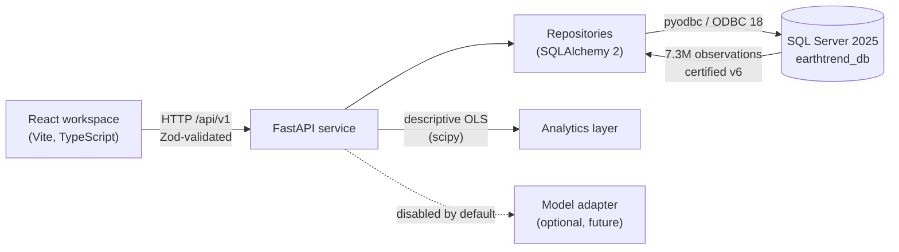
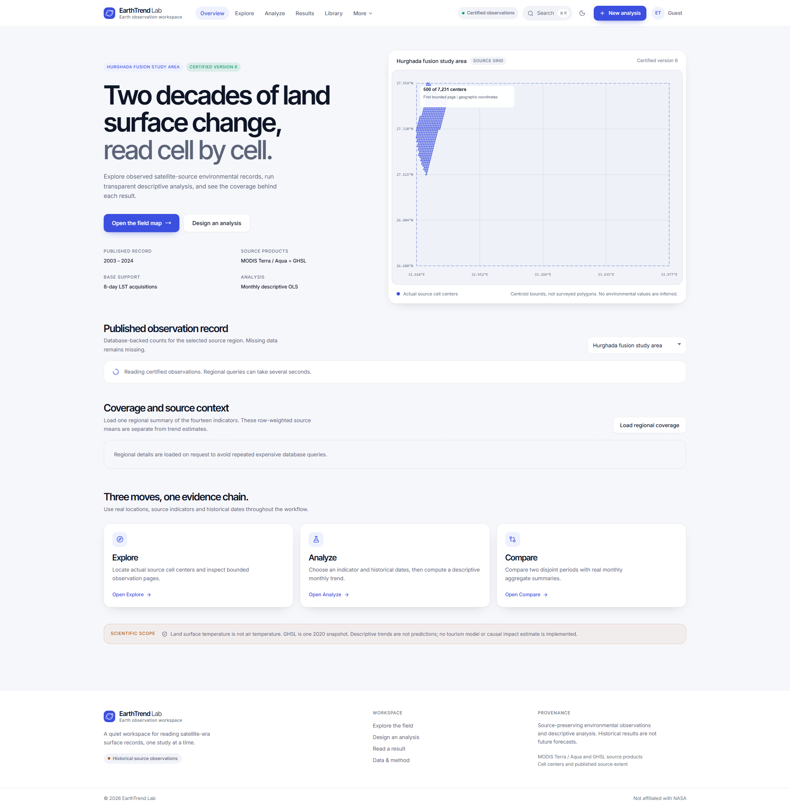
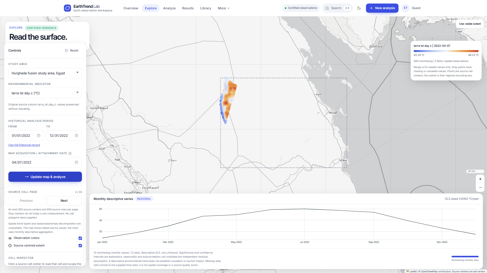
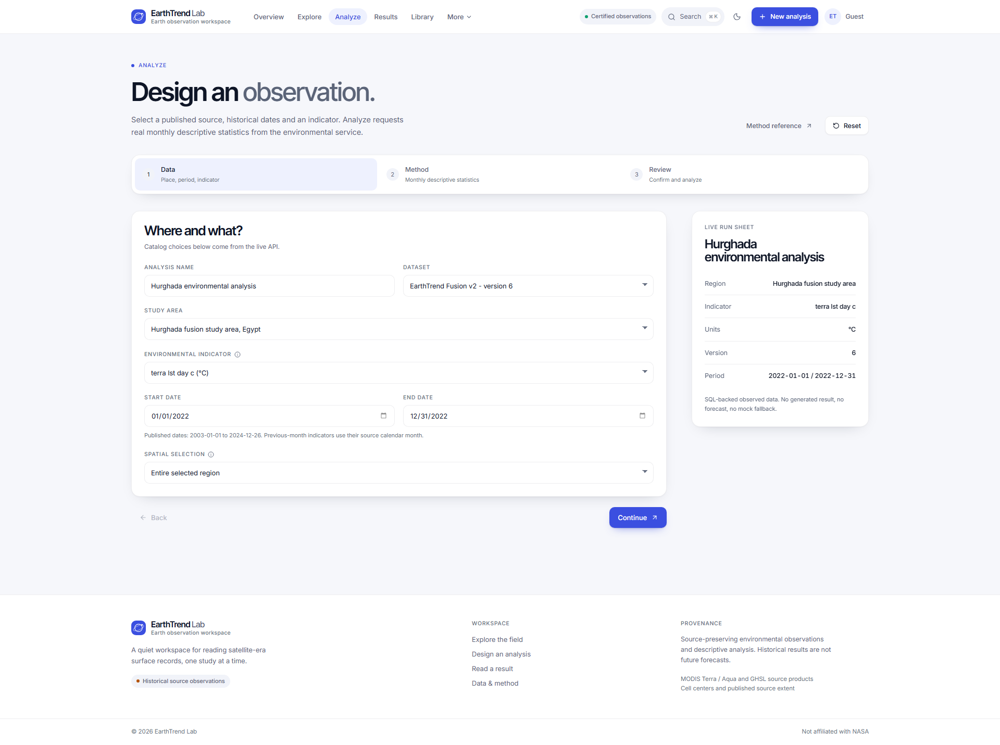
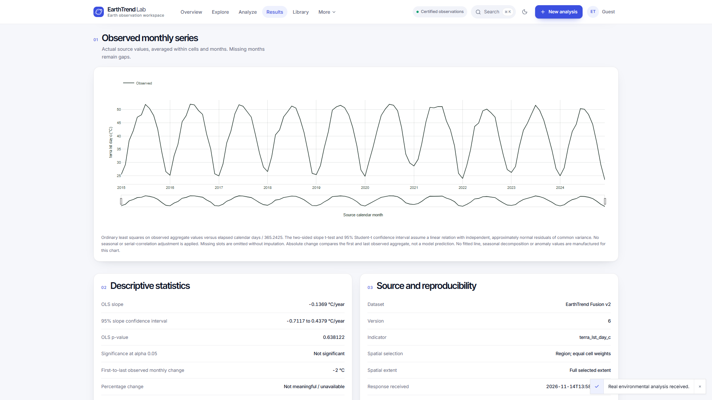
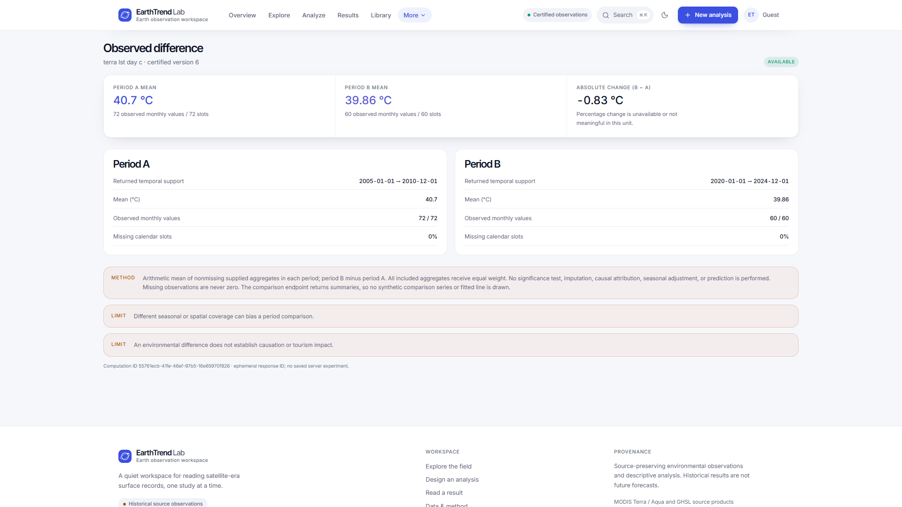
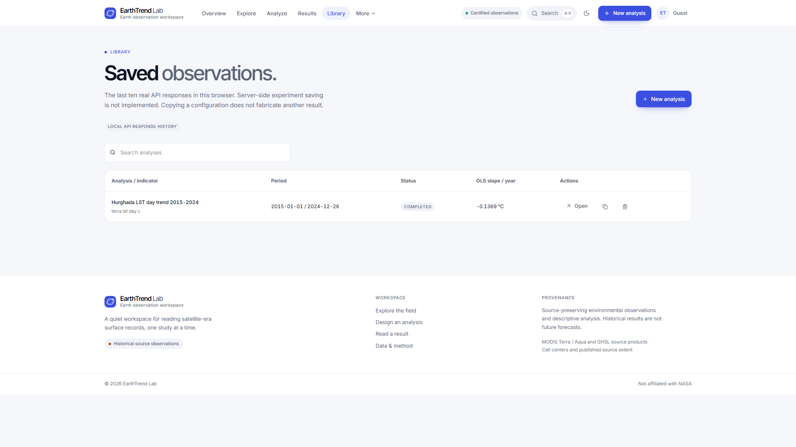
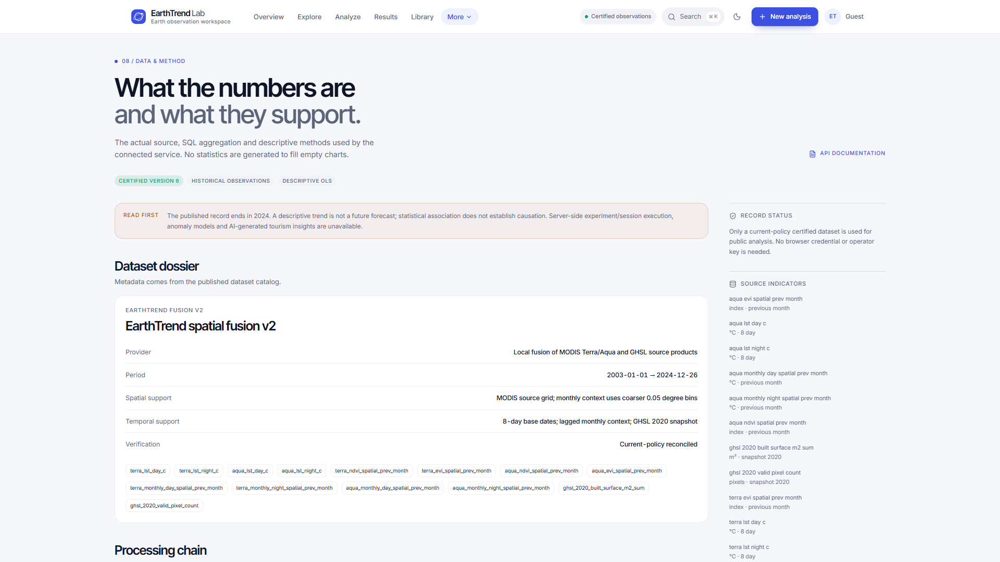

# EarthTrend Lab

**EarthTrend Lab** (Earth Trend Detective) is an observational environmental-analysis workspace. It reads a certified satellite-era dataset — MODIS Terra/Aqua Land Surface Temperature, NDVI/EVI vegetation indices and the GHSL 2020 built-surface snapshot for the Hurghada (Egypt) study area — from Microsoft SQL Server through a FastAPI service, and presents transparent descriptive statistics in a React workspace.

The application answers one question honestly: *what did the observed record show between 2003 and 2024?* It contains no forecasts, no trained models, no tourism measurements and no invented values. Every number displayed comes from the certified database.

- **Live dataset (version 6, certified):** 7,317,772 observations · 7,231 spatial cells · 2003-01-01 → 2024-12-26
- **Analysis:** descriptive OLS on monthly aggregates, with observed-versus-missing support shown alongside every result
- **Integrity rule:** missing observations stay null. They are never zero-filled, interpolated or rescaled.

---

## 1. Purpose

The project demonstrates how a research-grade environmental dataset can be served and explored without exaggerating what the data supports. It was built to make the distance between *measurement*, *aggregation* and *interpretation* visible: every result page carries its methodology, its support statistics and its limits.

## 2. Main features

| Feature | Status | Notes |
|---|---|---|
| Overview dashboard | Implemented | Dataset summary, indicator means, data coverage |
| Explorer (map + observations + trend) | Implemented | Real cell centroids, snapshot observations, monthly trend |
| Research Lab (guided analysis) | Implemented | Region/indicator/period selection → real OLS trend |
| Results | Implemented | Series chart, statistics, map, CSV/JSON export |
| Comparison | Implemented | Two disjoint historical periods, same pinned version |
| Companion (read-out) | Implemented | Plain-language read of the actual API response |
| Methodology, Settings | Implemented | Statistical limits; local cache/config inspection |
| GHSL trends | Intentionally unavailable | GHSL 2020 is a single snapshot; API returns HTTP 422 |
| Tourism / air temperature / predictions | Intentionally unavailable | No verified source data; labelled unavailable everywhere |
| Model integration layer | Prepared, disabled | Backend adapter exists; requires a real model to enable |

## 3. Architecture overview



Key properties:

- The frontend talks **only** to the HTTP API. There is no mock fallback anywhere in live routes.
- All request/response payloads are validated with **Zod** (frontend) and **Pydantic v2** (backend).
- Analytical queries aggregate **inside SQL Server**; the API never ships raw million-row tables.
- The dashboard aggregate is a process-level cache keyed by dataset-version certificate; certified data is immutable, so the cache cannot serve stale means.

See [docs/ARCHITECTURE.md](docs/ARCHITECTURE.md) for details and a data-flow diagram.

## 4. Technology stack

| Layer | Technology |
|---|---|
| Frontend | React 19, TypeScript, Vite 8, Tailwind CSS 4, React Router 7 |
| Data fetching / state | TanStack Query 5, Zustand 5 |
| Validation | Zod 4 (frontend), Pydantic v2 (backend) |
| Charts / maps | Plotly (official `plotly-basic` bundle, lazy-loaded), Leaflet via react-leaflet (lazy-loaded) |
| Backend | Python 3.13, FastAPI, SQLAlchemy 2.x, Alembic, pyodbc 5 |
| Database | Microsoft SQL Server 2025 Developer, Windows Authentication, ODBC Driver 18 |
| Statistics | SciPy (OLS inference: slope, p-value, Student-t confidence interval) |
| QA | node:test (frontend), pytest (backend), oxlint, ruff, `tsc -b`, GitHub Actions |

## 5. Repository structure

```
├── src/                    # React frontend (features, components, services, store, types)
│   ├── features/           # Page-level features (overview, explorer, lab, results, …)
│   ├── components/         # Shared UI: charts, maps, layout, common primitives
│   ├── services/api/       # HTTP client, validated adapter, Zod schemas
│   ├── hooks/              # TanStack Query hooks (useEnvironment)
│   ├── store/              # Zustand stores (useLabStore, useAppStore)
│   └── types/              # Shared TypeScript interfaces
├── backend/
│   ├── app/
│   │   ├── main.py         # FastAPI application and routes
│   │   ├── models.py       # SQLAlchemy models (18 tables)
│   │   ├── repositories.py # Query construction (monthly aggregation, filters)
│   │   ├── schemas.py      # Pydantic request/response contracts
│   │   ├── core/           # Settings, database engine/session
│   │   └── services/       # Analytics, dashboard aggregation, ingestion, model adapter
│   ├── alembic/            # Migrations (4 revisions, additive)
│   ├── tests/              # pytest suite (API + SQL integration)
│   └── docs/               # Backend handoff, data dictionary, methods, OpenAPI dump
├── docs/                   # Project documentation (this repository's docs)
├── tests/                  # Frontend unit + live-integration tests (node:test)
├── scripts/                # Start-Backend.ps1 / Start-Frontend.ps1, audits
└── .github/workflows/      # CI (backend tests; frontend checks)
```

## 6. System requirements

- Windows 10/11 (the database uses Windows Integrated Authentication)
- Node.js ≥ 24 with npm ≥ 11
- Python 3.13 with the provided virtual environment (`backend/.venv`)
- Microsoft SQL Server 2025 (Developer edition works) with ODBC Driver 18
- The certified database `earthtrend_db` restored and reachable as `localhost` (see `backend/README.md`)

## 7. Installation

The repository ships with lockfiles; startup never installs packages.

```powershell
git clone https://github.com/Maria-Ashraf-Haleem/Earth-Trend-Detective.git
Set-Location Earth-Trend-Detective
npm ci                 # frontend dependencies (frontend only)
# backend dependencies live in backend/.venv (see backend/README.md)
```

## 8–10. Running the application

Two terminals:

```powershell
# Terminal 1 — API (http://127.0.0.1:8000, docs at /docs)
.\scripts\Start-Backend.ps1

# Terminal 2 — Frontend (http://localhost:5173)
.\scripts\Start-Frontend.ps1
```

`Start-Frontend.ps1` pins the API base URL and sets `VITE_DEMO_MODE=false`. Keep the frontend on `localhost:5173`: the backend CORS configuration allows exactly that origin.

Readiness check:

```powershell
Invoke-RestMethod http://127.0.0.1:8000/api/v1/health/readiness
# expected: status = ready, checks database/schema_current/data_verified = true
```

## 11. Environment variables

**Frontend (root)** — see [.env.example](.env.example):

| Variable | Purpose |
|---|---|
| `VITE_API_BASE_URL` | Service origin, e.g. `http://127.0.0.1:8000`; the client appends `/api/v1` once |
| `VITE_DEMO_MODE` | Compatibility flag only; live screens never fall back to demo data |

**Backend (`backend/.env`)** — see [backend/.env.example](backend/.env.example):

| Variable | Purpose |
|---|---|
| `SQL_SERVER`, `SQL_DATABASE`, `SQL_DRIVER` | Server host, database name, ODBC driver |
| `SQL_ENCRYPT`, `SQL_TRUST_SERVER_CERTIFICATE` | Local Developer Edition typically needs the certificate flag |
| `SQL_TIMEOUT`, `SQL_QUERY_TIMEOUT` | Login timeout and driver-enforced statement deadline (seconds) |
| `POOL_SIZE` | SQLAlchemy pool size |
| `CORS_ORIGINS` | Allowed browser origins (JSON array) |
| `IMPORT_API_KEY` | Random secret enabling `POST /api/v1/imports` (unset = disabled) |
| `MODEL_*` | Optional model integration (disabled by default) |

Never place database credentials or API keys in frontend environment variables.

## 12. SQL Server setup and connection

The database uses **Windows Integrated Authentication** — no password is stored anywhere. Connection is configured in `backend/.env` and built in `backend/app/core/database.py` (pyodbc connection string with `Trusted_Connection=yes`, pool pre-ping, per-connection query timeout). Verify driver availability with `Get-OdbcDriver` and database state with `SELECT name, state_desc FROM sys.databases`.

## 13. Database schema overview

18 application tables plus the `ml_features_v1` view. Core tables:

- `observations` — 7.3M source rows; `cell_id`, `dataset_version_id`, `observed_on`, 14 measurement columns, QA metadata. Clustered on `id`; unique grain `(dataset_version_id, observed_on, cell_id)`.
- `spatial_cells` — 7,231 cell centroids (`longitude`, `latitude`, `region_id`, `grid_id`)
- `regions`, `locations` — study-area geography (bounding-box provenance is explicit)
- `datasets`, `dataset_versions` — logical dataset and immutable, hash-identified versions with validation certificates
- `import_jobs`, `import_batches`, `import_logs`, `import_quarantine` — full ingestion audit trail
- `quality_reports`, `analysis_runs`, `trend_results`, `period_comparisons`, `environmental_summaries`, `tourism_observations` — reserved/auxiliary structures

Details, indexes and the view definition: [docs/DATABASE.md](docs/DATABASE.md).

## 14. Dataset versioning

Publication is certificate-driven. A dataset version becomes *certified* only when its `validation_json` proves current-policy reconciliation (`reconciled = true` and the matching `validation_policy` version). The API pins every analysis to the latest certified version (currently **version 6**) and refuses uncertified versions unless a caller presents an explicit import key — and even then labels the response as a preview. Changing the certified version requires a justified migration plan, never an in-place edit.

## 15. API documentation

- Interactive OpenAPI: `http://127.0.0.1:8000/docs`
- Human contract summary: [docs/API.md](docs/API.md) and [backend/docs/FRONTEND_CONTRACT.md](backend/docs/FRONTEND_CONTRACT.md)

Primary endpoints (prefix `/api/v1`): `/regions`, `/regions/{id}/cells`, `/indicators`, `/variables`, `/datasets`, `/observations`, `/dashboard/summary|environmental-overview|data-coverage`, `/analysis/trends`, `/analysis/compare`, `/model/status`, `/model/predictions`, `/imports` (read), `/quality/reports`. Legacy experiment/session routes answer HTTP 501 by design.

## 16. Data sources and provenance

- **MODIS Terra (MOD11A2/MOD13A2-family products)** — LST day/night 8-day composites; NDVI/EVI 16-day, attached as previous-month context
- **MODIS Aqua (MYD11A2-family products)** — same structure, always distinguishable from Terra
- **GHSL 2020 built-surface** — a single snapshot (built-surface m², valid pixel count); *not* an annual series
- **Fusion dataset** `earthtrend-spatial-fusion-v2` — local fusion with sha256-identified versions and a validation certificate

Terra and Aqua are never mixed; day and night LST are never silently combined. Provenance travels through API responses (`dataset_version_id`, verification status, warnings).

## 17. Scientific methodology

Descriptive ordinary least squares over monthly equal-cell-weight aggregates: slope per elapsed year, p-value, Student-t confidence interval where estimable. The regression is **descriptive history, not forecasting**; a slope does not establish causality. Seasonality and serial correlation are acknowledged as limits (warnings accompany responses). Unsupported statistics remain null rather than approximate. Full method: [docs/METHODOLOGY.md](docs/METHODOLOGY.md) and [backend/docs/STATISTICAL_METHODS.md](backend/docs/STATISTICAL_METHODS.md).

## 18. Missing-data handling

- Missing measurements are returned as JSON `null` — never `0`.
- Monthly slots without any observation exist in the series as `null` points with explicit `total_slots` / `missing_data_ratio` accounting.
- LST is land surface temperature, not air temperature; NDVI/EVI are indices, not tree counts.
- Empty-region extents stay `null`; no invented coordinates.

## 19. Running tests

```powershell
# Frontend (unit; live integration is opt-in against a running backend)
npm test
$env:RUN_LIVE_API_TESTS='1'; npm run test:integration

# Backend (unit + API without SQL Server)
Set-Location backend
.\.venv\Scripts\python.exe -m pytest -q

# Backend incl. live SQL Server integration
$env:RUN_SQL_TESTS='1'; .\.venv\Scripts\python.exe -m pytest -q
```

Current verified results are in [docs/DEVELOPMENT.md](docs/DEVELOPMENT.md).

## 20. Production build

```powershell
npm run build      # tsc -b && vite build
npm run preview    # serve the production bundle locally
```

The build code-splits route pages; Leaflet and Plotly load only when a map or chart is actually rendered.

## 21. Troubleshooting

| Symptom | Cause / fix |
|---|---|
| UI shows "Backend unavailable" | API not started, or wrong `VITE_API_BASE_URL`. Start `Start-Backend.ps1` first. |
| Readiness returns `not_ready` | Database offline or schema not current; check `SQL_SERVER`/`SQL_DATABASE` and the service. |
| `SQL Driver not found` | Install ODBC Driver 18; `Get-OdbcDriver` lists installed drivers. |
| TLS/certificate error on connect | Local Developer Edition self-signed certificate: set `SQL_TRUST_SERVER_CERTIFICATE=true` locally. |
| Slow first dashboard load after restart | Cold buffer pool + first aggregate scan; the backend pre-warms at startup. Subsequent loads are cached. |
| `npm ci` fails on optional native packages | Restore a clean checkout; the lockfile contains all required optional dependencies. |

## 22. Known limitations

- The historical record ends **2024-12-26**; there is no current-date data.
- GHSL supports snapshot maps only (HTTP 422 for trends).
- Tourism, hotel occupancy, arrivals and ambient air temperature are not available and are labelled so.
- Trend significance is exploratory (no seasonal or autocorrelation correction).
- The model integration layer has no trained model behind it.
- Browser-based end-to-end automation has not been executed in this repository's CI (API/store-level integration tests cover the same flow).

## 23. Security notes

- Windows Integrated Authentication; no passwords in the repository or connection strings.
- Import submission is disabled until `IMPORT_API_KEY` is configured (constant-time comparison).
- Error responses never expose stack traces, SQL, credentials or filesystem paths; they carry a `request_id` for log correlation.
- CORS allows only the documented frontend origin; methods limited to GET/POST.
- All SQL is parameterized through SQLAlchemy expressions; no string-built SQL with user values.
- The optional model adapter keeps provider keys server-side and validates provider responses.

## 24. Contribution guidelines

- Preserve scientific provenance and the missing-data rules in every change.
- Do not fabricate measurements, forecasts or validation claims.
- Run `npm run build`, `npm test`, and `python -m pytest -q` before proposing changes.
- Keep API changes backward-compatible with the published contract (`backend/docs/FRONTEND_CONTRACT.md`).
- Commit style: short, imperative subjects (`fix: …`, `feat: …`, `chore: …`).

## 25. Application screenshots

### Application Visual Map

```mermaid
%%{init: {'theme': 'dark', 'themeVariables': {'primaryColor': '#1e293b', 'edgeColor': '#64748b', 'backgroundColor': '#0f172a'}} }%%
graph TD
    %% Central node
    core[EarthTrend Lab<br/>Earth Observation &<br/>Environmental Analysis Platform]
    core:::center

    %% Branches
    subgraph A Explore
        direction TB
        O[Overview Dashboard]
        M[Interactive Geographic Map]
        O:::leaf M:::leaf
    end

    subgraph B Research
        direction TB
        C[Analysis Configuration]
        R[Request Review]
        C:::leaf R:::leaf
    end

    subgraph C Analyze & Compare
        direction TB
        T[Monthly Trend Results]
        P[Regional Period Comparison]
        T:::leaf P:::leaf
    end

    subgraph D Data & Knowledge
        direction TB
        L[Saved Runs Library]
        S[Methodology & Data Sources]
        L:::leaf S:::leaf
    end

    core --> A
    core --> B
    core --> C
    core --> D

    classDef center: text-center;
    classDef leaf: fill:#1e293b,stroke:#3b82f6,stroke-width:2px,rx:4px,ry:4px;
```

The mind map above visualizes the EarthTrend Lab architecture using the eight genuine application screenshots as leaf nodes, rendered via Mermaid in GitHub. It uses the application's indigo/blue/cyan visual language on a dark navy background.

[View static PNG](./docs/screenshots/earthtrend-mindmap.png)

### Explore the Platform

A curated gallery of the eight real application screenshots, organized by functional domain. All images are 1920×1080px captures from the desktop viewport, taken directly from the running application against the certified backend (dataset version 6).

| **Explore** | |
|---|---|
|  | **Overview Dashboard** — Published observation record, spatial cells counts, first/last observation dates from the certified v6 dataset. |
|  | **Interactive Geographic Map** — Source cells on an OpenStreetMap-backed view with linked monthly series chart. |

| **Research Lab** | |
|---|---|
|  | **Analysis Configuration** (Step 1) — Place, period, and indicator selection against the live API. |
|  | **Request Review** (Step 3) — Confirmed request summary before analysis execution. |

| **Analysis & Comparison** | |
|---|---|
|  | **Monthly Trend Results** — Observed monthly series with actual data from the certified dataset; descriptive OLS statistics. |
|  | **Regional Period Comparison** — Two disjoint historical periods with observed period means, absolute change, and percentage change (where meaningful). |

| **Data & Methodology** | |
|---|---|
|  | **Saved Runs Library** — Real API responses retained in this browser; library contains no seeded demo results. |
|  | **Methodology & Data Sources** — Dataset dossier, processing chain, and statistical methods (descriptive OLS, period comparison, missing-data handling). |

**Verification — All eight screenshots are genuine captures** from the running EarthTrend Lab application (`localhost:5173`) with the backend serving certified dataset version 6. Captured via Playwright browser automation after all charts, maps, and data finished rendering. No mock data, no placeholders, no fabricated measurements, and no exposed credentials or personal information appear in any image.

[View the mind map PNG](./docs/screenshots/earthtrend-mindmap.png)
