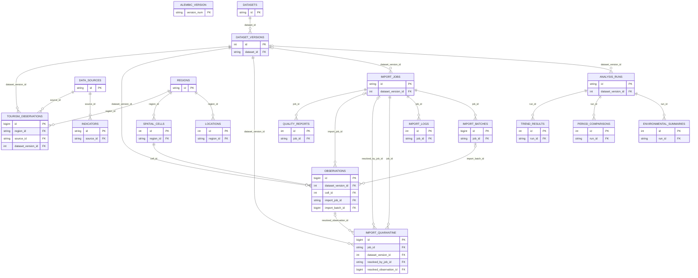

# Earth Trend Detective — Actual Database Architecture Review

**Audit date:** 13 November 2026 (Africa/Cairo). **Snapshot:** live SQL metadata captured at 2026-11-13T08:09:55.2810846 UTC; source certificate recorded at 2026-11-13T07:53:44.435241+00:00. Repository base commit: `1b8c35a`. The backend is an uncommitted working implementation; this report does not imply a committed release.

**Audit boundary:** This is a read-only review of the existing implementation. Only this Markdown report is created. No application file, schema, database record, migration revision, dataset, export or existing documentation is changed. No ingestion, fixture test suite, Alembic upgrade/downgrade, commit or push is executed. The prior implementation/certification work is historical context, not an operation performed by this audit.

**Path convention:** Every relative backend path below resolves against **C:/Users/abdel/Downloads/Backend/backend**. Frontend paths prefixed `../src` resolve against the repository root `C:/Users/abdel/Downloads/Backend`.

**Evidence labels:** **VERIFIED** = observed through the stated read-only SQL/file/HTTP check or an explicitly identified prior executed result. **CODE INSPECTED** = behavior established by current code, without exercising its write path. **NOT VERIFIED** = not measured/reproduced in this audit. **NOT IMPLEMENTED** = no current implementation/artifact. **RECOMMENDED CHANGE** = proposal only; requires review and later authorization. Query identifiers refer to the executable SELECT-only appendix in section 16.

## 1. Executive summary

The current system is a real FastAPI/SQLAlchemy/pyodbc backend on SQL Server. It contains **18 application tables plus `alembic_version`**, **23 foreign keys**, **39 indexes**, **14 CHECK constraints**, and the **51-column `dbo.ml_features_v1` view**. All inventoried indexes are enabled, and all current FK/CHECK constraints are enabled and trusted. Read-only Alembic metadata comparison returned no schema differences; the live revision is **`f932c7a14d58`**. [VERIFIED: Q-SCHEMA, Q-KEYS, Q-INDEXES, Q-MIGRATION; live reflection/`compare_metadata`]

The observation fact contains **exactly 7,317,772 rows**, representing **7,231 cells**, from **2003-01-01 through 2024-12-26**. Its enabled unique business-key constraint makes the physical business-key count equal to the row count and prevents duplicate keys. There are **232,769 resolved historical quarantine records and zero pending records**. A stored current-policy independent reconciliation certificate agrees with source counts and all fourteen feature coverage counts. Safe live health and readiness reads returned 200; no analytical GET was called because those routes write history. [VERIFIED: Q-OBS, Q-QUARANTINE, Q-CERTIFICATE; `/health`, `/api/v1/health/database`, `/api/v1/health/readiness`]

The design is a reasonable source-faithful foundation for this single fusion dataset, but **it is not yet an approved final production database architecture**. The highest-priority issues are:

1. **Fresh API/CLI quarantine-replay scope initialization is inconsistent with the worker.** A prepared replay lacks `quarantine_max_id` but skips initialization and then reads that key. This is a concrete **CODE INSPECTED** defect, not an audit-time runtime reproduction. Existing successful recovery used the direct helper's initialization path. See D1.
2. **Provenance and audit integrity are incompletely enforced at the database boundary.** Independent FKs do not ensure job/batch/version coherence; job counter reconciliation and JSON validity lack SQL checks; legacy fact rows have nullable job/batch links. Current counter violations are zero, and no actual cross-link corruption is alleged. See D2–D4.
3. **Analytical GET routes persist execution history.** They INSERT analysis/result rows and COMMIT, so they are not read-only retrieval operations and require write privileges. Cached/retried/prefetched GETs can create additional history. This is a concrete code fact, not a write test performed in the audit. See D10.

Performance and finite disk capacity are additional review priorities: exact counts/aggregations can access millions of wide rows, indexes do not cover the measurement values, and repeated context/retained JSON audit consumes space. Their actual query-plan/latency impact remains unmeasured here; see D7–D9.

No trained ML model, prediction service, tourism outcomes or verified air-temperature dataset exists. The ML view is a data interface, not a predictor. The clean-export service is implemented and had tiny-fixture tests, but **the large clean CSV and its public manifest are absent** at this snapshot; this audit deliberately does not create them. [VERIFIED file existence; CODE INSPECTED `app/services/verification.py:132`]

## 2. Repository structure relevant to the database

| Exact path relative to backend root | Actual responsibility |
| --- | --- |
| `app/main.py:43` | FastAPI app object, CORS, request IDs/error handlers and all HTTP routes. Versioned router starts at line 49; there is no separate app/api/v1 endpoint package. |
| `README.md; .env.example; requirements.txt; requirements-dev.txt; requirements-lock.txt; pyproject.toml` | Existing setup, nonsecret configuration example, pinned runtime/test environment and test/lint configuration. Actual installed versions were inspected; no packages installed. |
| `alembic.ini; ../.github/workflows/backend-tests.yml` | Alembic path configuration and repository-root Windows/Python CI definition. CI was not run remotely by this audit. |
| `app/core/config.py:8` | Pydantic settings and .env loading, nonsecret defaults, database-name validation, CORS/source paths/batch size/import-key configuration. |
| `app/core/database.py:10` | mssql+pyodbc URL built for Windows Integrated Authentication; cached pooled engine and session factory; per-request session dependency. |
| `app/models.py:17` | Declarative Base and 18 application entities, including dynamic fourteen-measurement mapping on Observation. |
| `app/schemas.py:7` | Pydantic filter/body/response contracts, bbox/date validation, explicit nullable states and pagination models. |
| `app/repositories.py:10` | Version resolution, indicator validation, bounded raw filters, SQL-only equal-cell monthly aggregation and observation serialization. |
| `app/services/catalog.py:9` | Idempotent logical dataset/region/source/indicator seeding. Dataset/region constants at lines 5-6 specialize this importer to the Hurghada fusion. |
| `app/services/ingestion/validation.py:104` | Source-specific 43-column parser; exact integral numeric QA encodings, coherent absent-sensor state, dates, coordinates, finite values and raw hash. |
| `app/services/ingestion/pipeline.py:85` | Pinned SQL application lock; batch writes/audit; full CSV ingestion at line 347, historical audit backfill at 466, scoped quarantine replay at 528. |
| `app/services/verification.py:26` | Independent source/SQL/job/coverage reconciliation and stored certificate. validate_dataset at 119 writes validation state; export_clean at 132 writes a new CSV/manifest. Neither was executed in this audit. |
| `app/services/analytics.py:107` | Pure descriptive OLS statistics and period means; no SQL session, trained predictor, tourism model or causal service. |
| `app/cli.py:53` | Operational commands: bootstrap, catalog seed, import/retry, worker dispatch, certification and clean export. These mutation/export commands were not run during this audit. |
| `scripts/profile_source.py:83` | Read-only source parsing but writes profile/checkpoint artifacts when invoked. Full profiling and resumable revalidation at line 195; existing artifacts inspected only. |
| `alembic/env.py` | Target metadata and online/offline migration setup. Read-only compare_metadata used here; no upgrade, downgrade or schema installation executed. |
| `alembic/versions/` | Four migrations inventoried in section 7. Actual live view definition also compared with migration VIEW_SQL. |
| `sql/schema.sql` | Existing generated schema artifact. It is a review/install artifact, not the authority for current live state. |
| `tests/conftest.py` | SQL Server integration fixtures use outer transactions/savepoints. They perform writes even though rolled back, so they were not run in this audit. |
| `tests/test_ingestion.py; tests/test_quarantine.py` | Existing parser/import/audit/retry tests. Successful direct-helper replay coverage does not cover the prepared API/CLI scope defect D1. |
| `tests/test_readiness_audit_api.py; tests/test_verification.py; tests/test_ml_view.py` | Existing readiness/bbox/audit, certification/export and ML-view regression cases. Prior results are separated from audit-time verification. |
| `docs/SOURCE_PROFILE.json; docs/INGESTION_VALIDATION.json` | Existing full-source current-policy result and reconciliation evidence. Live dataset_versions.validation_json was read independently. |
| `docs/ML_HANDOFF.md; docs/INGESTION_AUDIT.md` | Existing data-consumer, leakage, precision and audit-interface documentation; not modified. |
| `docs/FINAL_REPORT.md; docs/openapi.json` | Existing documentation artifacts are stale relative to current implementation; see D11. They were left untouched. |
| `../src/services/api/earthtrend.ts; ../src/store/useLabStore.ts` | Existing frontend API/mock path. Frontend remains unchanged and still contains local mock execution; it is not proof of database-backed UI behavior. |

There is no separate `security.py`, generic repository package or pre-existing REST backend outside these modules. Import authorization is in `app/main.py:488`. Routes are grouped by OpenAPI tags in the main module. The database models in `app/models.py` are ORM entities, not trained ML models. [CODE INSPECTED]

## 3. SQL Server configuration and connection lifecycle

| Item | Current finding | Status / evidence |
| --- | --- | --- |
| Database / host | `earthtrend_db` on configured `localhost`, default instance | VERIFIED Q-CONFIG; CODE INSPECTED settings |
| Edition / version | Enterprise Developer Edition (64-bit); 17.0.1000.7, RTM | VERIFIED Q-CONFIG |
| Compatibility / collation | 170; `SQL_Latin1_General_CP1_CI_AS`, code page 1252 | VERIFIED Q-CONFIG; Unicode conversion diagnostic |
| Authentication used | Windows Integrated Authentication, current audit connection `NTLM` | VERIFIED Q-CONNECTION; `Trusted_Connection=yes` in database.py |
| Server authentication policy | `IsIntegratedSecurityOnly=0`: server permits mixed authentication; this application still uses Windows authentication | VERIFIED Q-CONFIG. Do not describe the server as Windows-only |
| Driver / dialect | ODBC Driver 18 for SQL Server; `mssql+pyodbc`; pyodbc 5.5.0, SQLAlchemy 2.0.57 | VERIFIED installed package metadata; CODE INSPECTED config |
| Transport / encryption | Audit connection: Shared memory, TSQL, encryption TRUE | VERIFIED Q-CONNECTION |
| Pool | SQLAlchemy QueuePool, size 5, overflow 5, pre-ping enabled, recycle 1800 s | CODE INSPECTED `app/core/database.py:25` |
| Driver pooling | `pyodbc.pooling=True`; not disabled by application code | VERIFIED interpreter setting; driver-pool behavior/load NOT VERIFIED |
| Sessions | Cached sessionmaker; `expire_on_commit=False`; one request-owned synchronous Session | CODE INSPECTED database.py:34–45 |
| Isolation | Lock-based READ COMMITTED defaults; RCSI false, snapshot isolation OFF | VERIFIED Q-CONFIG; no application snapshot isolation override |
| Query Store | READ_WRITE, 2 MiB used, 1000 MiB cap | VERIFIED Q-PERFORMANCE |
| Recovery | FULL; current `log_reuse_wait_desc=NOTHING` | VERIFIED Q-PERFORMANCE |
| Backup history | msdb reports full backup finish `2026-11-13 09:47:51`; no log backup finish recorded | VERIFIED Q-PERFORMANCE. Timestamp is server-local; restoreability/external backups/history retention NOT VERIFIED |

Pool limits are **per engine/process**, not a global ten-connection cap for API plus workers. No explicit `pool_timeout` is supplied; SQLAlchemy's normal default applies. `SQL_TIMEOUT` sets ODBC connection establishment timeout, not statement duration. A SQL command deadline is not implemented. No actual pool-saturation or connection-leak test was run. [CODE INSPECTED / NOT VERIFIED]

Request read sessions close without an explicit commit; pending read transactions are rolled back on close. Exceptions call `rollback()`. Import submission and analytical execution explicitly commit. The CSV worker pins both a session-owned `sys.sp_getapplock` and its Session to one connection across batch commits, then releases the lock. Transactions keep observations, batch audit, quarantine, progress and quality counters together. [CODE INSPECTED database.py:38; pipeline.py:85,170; main.py:340,495]

| Setting | Actual use / default policy |
| --- | --- |
| `SQL_SERVER` | Configured localhost; default instance, no named-instance suffix. |
| `SQL_DATABASE` | Configured earthtrend_db; identifier is restricted to letters/digits/underscore. |
| `SQL_DRIVER` | Configured ODBC Driver 18 for SQL Server; 64-bit Python environment. |
| `SQL_ENCRYPT` | true; live audit connection reports encrypt_option TRUE. |
| `SQL_TRUST_SERVER_CERTIFICATE` | true in this local configuration; distributed settings default false. Certificate-chain verification is bypassed locally. |
| `SQL_TIMEOUT` | 10 seconds for connection establishment; not a SQL command execution deadline. |
| `POOL_SIZE` | 5; max_overflow=5 and pool_recycle=1800 are fixed in database.py. |
| `CORS_ORIGINS` | List of allowed frontend origins; current localhost:5173. This is not authentication. |
| `IMPORT_API_KEY` | Secret setting name only; value intentionally not disclosed. Required for HTTP submission; unset configuration disables POST /imports. |
| `DATA_FILE_PATH` | Server-side configured CSV source; no HTTP file-path parameter. |
| `AUDIT_FILE_PATH` | Server-side supplied provenance audit JSON source. |
| `IMPORT_BATCH_SIZE` | Current configured default 2000, allowed 100..20000; actual scoped recovery used 12 batches for 120000 rows. |
| `LOG_LEVEL` | Structured application/ingestion log level; default INFO. |


Installed runtime package versions were read without installation: FastAPI 0.162.5, SQLAlchemy 2.0.57, pyodbc 5.5.0, Alembic 1.20.1, Pydantic 2.14.3, pydantic-settings 2.16.2 and SciPy 1.18.1. The prepared interpreter is Python 3.13.2 x64.

All defaults are supplied in code; an unset environment is not proof of a working deployment. `.env` is loaded from the working directory with UTF-8 BOM handling. Actual secret values, Windows account names and full connection strings are intentionally excluded from this report.

## 4. Complete actual database schema

**VERIFIED:** Every application table below exists in `dbo` and has a matching SQLAlchemy entity. `alembic_version` is a normal framework table without an application entity. There are no model-only missing tables at this snapshot. Zero-row reserved tables are **implemented but unpopulated**, not planned tables. [Q-SCHEMA; current model registry]

Row counts marked metadata estimates come from `sys.dm_db_partition_stats` with only heap/clustered partitions counted, preventing double-counting secondary indexes. Exact counts are identified separately. The storage column below is **base heap/clustered reserved storage only**, not the table's complete secondary-index footprint.

| Table | Model / source | Rows | Count basis | Base reserved MiB | API use |
| --- | --- | ---: | --- | ---: | --- |
| `dbo.alembic_version` | Framework — `alembic/env.py` | 1 | sys.dm_db_partition_stats estimate | 0.07 | Read by readiness only. |
| `dbo.analysis_runs` | `AnalysisRun` — `app/models.py:208` | 1 | sys.dm_db_partition_stats estimate | 0.07 | Written by analysis GET routes; no history-by-ID retrieval endpoint. |
| `dbo.data_sources` | `DataSource` — `app/models.py:53` | 3 | sys.dm_db_partition_stats estimate | 0.07 | Indirect source IDs in indicators; no dedicated sources endpoint. |
| `dbo.dataset_versions` | `DatasetVersion` — `app/models.py:68` | 1 | sys.dm_db_partition_stats estimate | 0.15 | Dataset detail/catalog, observation selection, readiness and analytics provenance. |
| `dbo.datasets` | `Dataset` — `app/models.py:60` | 1 | sys.dm_db_partition_stats estimate | 0.07 | GET /datasets and GET /datasets/{dataset_id}. |
| `dbo.environmental_summaries` | `EnvironmentalSummary` — `app/models.py:232` | 0 | sys.dm_db_partition_stats estimate | 0.00 | No current API reader/writer; dashboards query observations directly. |
| `dbo.import_batches` | `ImportBatch` — `app/models.py:144` | 12 | Exact SELECT / grouped counts | 0.07 | GET /imports/{job_id}/batches. |
| `dbo.import_jobs` | `ImportJob` — `app/models.py:124` | 3 | Exact SELECT / grouped counts | 0.07 | Import list/detail/submission; default-version selection and readiness. |
| `dbo.import_logs` | `ImportLog` — `app/models.py:189` | 2,003 | Exact SELECT / grouped counts | 0.33 | Latest 100 exposed by GET /imports/{job_id}. |
| `dbo.import_quarantine` | `ImportQuarantine` — `app/models.py:165` | 232,769 | Exact SELECT / grouped counts | 898.38 | Paginated metadata read; POST /imports checks existence for retry. Raw payload omitted publicly. |
| `dbo.indicators` | `Indicator` — `app/models.py:81` | 14 | sys.dm_db_partition_stats estimate | 0.07 | GET /indicators, temperature /variables catalog and indicator validation. |
| `dbo.locations` | `Location` — `app/models.py:30` | 0 | sys.dm_db_partition_stats estimate | 0.00 | GET /locations. |
| `dbo.observations` | `Observation` — `app/models.py:101` | 7,317,772 | Exact SELECT / grouped counts | 4797.53 | Observation, dashboard, trend and period-comparison queries. |
| `dbo.period_comparisons` | `PeriodComparison` — `app/models.py:225` | 0 | sys.dm_db_partition_stats estimate | 0.07 | Written by GET /analysis/compare; no stored-result retrieval API. |
| `dbo.quality_reports` | `QualityReport` — `app/models.py:200` | 3 | sys.dm_db_partition_stats estimate | 0.07 | GET /quality/reports. |
| `dbo.regions` | `Region` — `app/models.py:21` | 1 | sys.dm_db_partition_stats estimate | 0.07 | Regions, cells and geographic-scope validation. |
| `dbo.spatial_cells` | `SpatialCell` — `app/models.py:41` | 7,231 | Exact SELECT / grouped counts | 0.70 | Region extent/cells and observation/analysis spatial joins. |
| `dbo.tourism_observations` | `TourismObservation` — `app/models.py:239` | 0 | sys.dm_db_partition_stats estimate | 0.00 | No dedicated API reader/writer; dashboards explicitly state tourism unavailable. |
| `dbo.trend_results` | `TrendResult` — `app/models.py:218` | 1 | sys.dm_db_partition_stats estimate | 0.07 | Written by trend GETs; no stored-result retrieval API. |


The following column/constraint/index inventory is generated from **live SQL reflection and system catalogs**, not guessed from the source model. Text columns use the database collation unless stated otherwise. `INTEGER` is SQL Server's `INT` synonym. JSON-mapped columns are physically `NVARCHAR(MAX)`; they are not a native JSON storage type. A dash in the default column means **no SQL server-side default**; Python ORM defaults such as UTC creation time and zero counters still exist in code. Nonclustered indexes implicitly carry the clustered key even when no explicit INCLUDE is shown.


### dbo.alembic_version

**VERIFIED — existing table.** Alembic's framework revision marker; no application ORM entity. Model: no SQLAlchemy application model; Alembic framework table.

| Column | Actual SQL Server type | Nullable | Key/reference | Server default / identity |
| --- | --- | --- | --- | --- |
| `version_num` | `VARCHAR(32)` | NO | PK | — |

Primary key: `alembic_version_pkc` (`version_num`).

Foreign keys: none.

Unique constraints (excluding PK): none; any additional unique index is listed below.

Indexes:

| Name | Kind / uniqueness | Keys | Explicit INCLUDE | Compression |
| --- | --- | --- | --- | --- |
| `alembic_version_pkc` | CLUSTERED; UNIQUE; PK | `[version_num]` | none | NONE |

CHECK constraints: none.

API relationship: Read by readiness only. Evidence: `Q-SCHEMA`, `Q-KEYS`, `Q-INDEXES` and `Q-ROWS`. All listed indexes are enabled; all current FK/CHECK constraints are enabled and trusted.

### dbo.analysis_runs

**VERIFIED — existing table.** Descriptive analysis execution identity, request parameters, source version, availability status and UTC-by-convention creation time. Model: `AnalysisRun` in `app/models.py:208`.

| Column | Actual SQL Server type | Nullable | Key/reference | Server default / identity |
| --- | --- | --- | --- | --- |
| `id` | `VARCHAR(36)` | NO | PK | — |
| `kind` | `VARCHAR(40)` | NO | — | — |
| `parameters` | `NVARCHAR(max)` | NO | — | — |
| `dataset_version_id` | `INTEGER` | YES | FK → `dbo.dataset_versions.id` | — |
| `created_at` | `DATETIME` | NO | — | — |
| `status` | `VARCHAR(30)` | NO | — | — |

Primary key: `PK__analysis__3213E83F213F6141` (`id`).

Foreign keys: `FK__analysis___datas__6383C8BA`: (`dataset_version_id`) → `dbo.dataset_versions` (`id`).

Unique constraints (excluding PK): none; any additional unique index is listed below.

Indexes:

| Name | Kind / uniqueness | Keys | Explicit INCLUDE | Compression |
| --- | --- | --- | --- | --- |
| `PK__analysis__3213E83F213F6141` | CLUSTERED; UNIQUE; PK | `[id]` | none | NONE |

CHECK constraints: none.

API relationship: Written by analysis GET routes; no history-by-ID retrieval endpoint. Evidence: `Q-SCHEMA`, `Q-KEYS`, `Q-INDEXES` and `Q-ROWS`. All listed indexes are enabled; all current FK/CHECK constraints are enabled and trusted.

### dbo.data_sources

**VERIFIED — existing table.** Source attribution catalog; currently Terra, Aqua and GHSL. Model: `DataSource` in `app/models.py:53`.

| Column | Actual SQL Server type | Nullable | Key/reference | Server default / identity |
| --- | --- | --- | --- | --- |
| `id` | `VARCHAR(40)` | NO | PK | — |
| `name` | `VARCHAR(200)` | NO | — | — |
| `documentation_url` | `VARCHAR(500)` | YES | — | — |

Primary key: `PK__data_sou__3213E83F601D9448` (`id`).

Foreign keys: none.

Unique constraints (excluding PK): none; any additional unique index is listed below.

Indexes:

| Name | Kind / uniqueness | Keys | Explicit INCLUDE | Compression |
| --- | --- | --- | --- | --- |
| `PK__data_sou__3213E83F601D9448` | CLUSTERED; UNIQUE; PK | `[id]` | none | NONE |

CHECK constraints: none.

API relationship: Indirect source IDs in indicators; no dedicated sources endpoint. Evidence: `Q-SCHEMA`, `Q-KEYS`, `Q-INDEXES` and `Q-ROWS`. All listed indexes are enabled; all current FK/CHECK constraints are enabled and trusted.

### dbo.dataset_versions

**VERIFIED — existing table.** Content-fingerprinted source registration, supplied private audit, independent validation certificate and validation time. Model: `DatasetVersion` in `app/models.py:68`.

| Column | Actual SQL Server type | Nullable | Key/reference | Server default / identity |
| --- | --- | --- | --- | --- |
| `id` | `INTEGER` | NO | PK | IDENTITY(1, 1) |
| `dataset_id` | `VARCHAR(80)` | NO | FK → `dbo.datasets.id` | — |
| `sha256` | `VARCHAR(64)` | NO | — | — |
| `source_size` | `BIGINT` | NO | — | — |
| `audit_json` | `NVARCHAR(max)` | NO | — | — |
| `created_at` | `DATETIME` | NO | — | — |
| `validation_json` | `NVARCHAR(max)` | NO | — | `('{}')` |
| `validated_at` | `DATETIME` | YES | — | — |

Primary key: `PK__dataset___3213E83F1283F70F` (`id`).

Foreign keys: `FK__dataset_v__datas__534D60F1`: (`dataset_id`) → `dbo.datasets` (`id`).

Unique constraints (excluding PK): `UQ__dataset___C47A1684222E7D86` (`[sha256]`).

Indexes:

| Name | Kind / uniqueness | Keys | Explicit INCLUDE | Compression |
| --- | --- | --- | --- | --- |
| `PK__dataset___3213E83F1283F70F` | CLUSTERED; UNIQUE; PK | `[id]` | none | NONE |
| `UQ__dataset___C47A1684222E7D86` | NONCLUSTERED; UNIQUE; constraint | `[sha256]` | none | NONE |
| `ix_dataset_versions_dataset_id` | NONCLUSTERED | `[dataset_id]` | none | NONE |

CHECK constraints: none.

API relationship: Dataset detail/catalog, observation selection, readiness and analytics provenance. Evidence: `Q-SCHEMA`, `Q-KEYS`, `Q-INDEXES` and `Q-ROWS`. All listed indexes are enabled; all current FK/CHECK constraints are enabled and trusted.

### dbo.datasets

**VERIFIED — existing table.** Logical dataset catalog; currently one spatial-fusion dataset. Model: `Dataset` in `app/models.py:60`.

| Column | Actual SQL Server type | Nullable | Key/reference | Server default / identity |
| --- | --- | --- | --- | --- |
| `id` | `VARCHAR(80)` | NO | PK | — |
| `name` | `VARCHAR(250)` | NO | — | — |
| `description` | `VARCHAR(2000)` | NO | — | — |

Primary key: `PK__datasets__3213E83F9610C5B7` (`id`).

Foreign keys: none.

Unique constraints (excluding PK): none; any additional unique index is listed below.

Indexes:

| Name | Kind / uniqueness | Keys | Explicit INCLUDE | Compression |
| --- | --- | --- | --- | --- |
| `PK__datasets__3213E83F9610C5B7` | CLUSTERED; UNIQUE; PK | `[id]` | none | NONE |

CHECK constraints: none.

API relationship: GET /datasets and GET /datasets/{dataset_id}. Evidence: `Q-SCHEMA`, `Q-KEYS`, `Q-INDEXES` and `Q-ROWS`. All listed indexes are enabled; all current FK/CHECK constraints are enabled and trusted.

### dbo.environmental_summaries

**VERIFIED — existing table.** Implemented reserved result relation; no current dashboard write path populates it. Model: `EnvironmentalSummary` in `app/models.py:232`.

| Column | Actual SQL Server type | Nullable | Key/reference | Server default / identity |
| --- | --- | --- | --- | --- |
| `id` | `INTEGER` | NO | PK | IDENTITY(1, 1) |
| `run_id` | `VARCHAR(36)` | NO | FK → `dbo.analysis_runs.id` | — |
| `summary_json` | `NVARCHAR(max)` | NO | — | — |

Primary key: `PK__environm__3213E83F7FDD3137` (`id`).

Foreign keys: `FK__environme__run_i__787EE5A0`: (`run_id`) → `dbo.analysis_runs` (`id`).

Unique constraints (excluding PK): none; any additional unique index is listed below.

Indexes:

| Name | Kind / uniqueness | Keys | Explicit INCLUDE | Compression |
| --- | --- | --- | --- | --- |
| `PK__environm__3213E83F7FDD3137` | CLUSTERED; UNIQUE; PK | `[id]` | none | NONE |
| `ix_environmental_summaries_run_id` | NONCLUSTERED | `[run_id]` | none | NONE |

CHECK constraints: none.

API relationship: No current API reader/writer; dashboards query observations directly. Evidence: `Q-SCHEMA`, `Q-KEYS`, `Q-INDEXES` and `Q-ROWS`. All listed indexes are enabled; all current FK/CHECK constraints are enabled and trusted.

### dbo.import_batches

**VERIFIED — existing table.** Atomic per-batch counters, source-ordinal bounds and reconciliation checks for post-migration ingestion. Model: `ImportBatch` in `app/models.py:144`.

| Column | Actual SQL Server type | Nullable | Key/reference | Server default / identity |
| --- | --- | --- | --- | --- |
| `id` | `BIGINT` | NO | PK | IDENTITY(1, 1) |
| `job_id` | `VARCHAR(36)` | NO | FK → `dbo.import_jobs.id` | — |
| `batch_number` | `INTEGER` | NO | — | — |
| `source_start_row` | `BIGINT` | NO | — | — |
| `source_end_row` | `BIGINT` | NO | — | — |
| `processed_rows` | `BIGINT` | NO | — | — |
| `inserted_rows` | `BIGINT` | NO | — | — |
| `duplicate_rows` | `BIGINT` | NO | — | — |
| `rejected_rows` | `BIGINT` | NO | — | — |
| `committed_at` | `DATETIME` | NO | — | — |

Primary key: `PK__import_b__3213E83FC4CE76BB` (`id`).

Foreign keys: `FK__import_ba__job_i__1BC821DD`: (`job_id`) → `dbo.import_jobs` (`id`).

Unique constraints (excluding PK): `uq_import_batch_number` (`[job_id],[batch_number]`).

Indexes:

| Name | Kind / uniqueness | Keys | Explicit INCLUDE | Compression |
| --- | --- | --- | --- | --- |
| `PK__import_b__3213E83FC4CE76BB` | CLUSTERED; UNIQUE; PK | `[id]` | none | NONE |
| `uq_import_batch_number` | NONCLUSTERED; UNIQUE; constraint | `[job_id],[batch_number]` | none | NONE |
| `ix_import_batches_job_id` | NONCLUSTERED | `[job_id]` | none | NONE |

CHECK constraints: `CK__import_batches__19DFD96B` — `([source_start_row]>(0) AND [source_end_row]>=[source_start_row])`; `CK__import_batches__1AD3FDA4` — `([inserted_rows]>=(0) AND [duplicate_rows]>=(0) AND [rejected_rows]>=(0))`; `ck_import_batch_reconciled` — `([processed_rows]=(([inserted_rows]+[duplicate_rows])+[rejected_rows]))`.

API relationship: GET /imports/{job_id}/batches. Evidence: `Q-SCHEMA`, `Q-KEYS`, `Q-INDEXES` and `Q-ROWS`. All listed indexes are enabled; all current FK/CHECK constraints are enabled and trusted.

### dbo.import_jobs

**VERIFIED — existing table.** Durable queue/execution state, scope, cumulative counters, source-ordinal checkpoint and safe failure code. Model: `ImportJob` in `app/models.py:124`.

| Column | Actual SQL Server type | Nullable | Key/reference | Server default / identity |
| --- | --- | --- | --- | --- |
| `id` | `VARCHAR(36)` | NO | PK | — |
| `dataset_version_id` | `INTEGER` | YES | FK → `dbo.dataset_versions.id` | — |
| `status` | `VARCHAR(20)` | NO | — | — |
| `processed_rows` | `BIGINT` | NO | — | — |
| `inserted_rows` | `BIGINT` | NO | — | — |
| `duplicate_rows` | `BIGINT` | NO | — | — |
| `rejected_rows` | `BIGINT` | NO | — | — |
| `checkpoint_row` | `BIGINT` | NO | — | — |
| `total_rows` | `BIGINT` | YES | — | — |
| `created_at` | `DATETIME` | NO | — | — |
| `started_at` | `DATETIME` | YES | — | — |
| `finished_at` | `DATETIME` | YES | — | — |
| `error_code` | `VARCHAR(80)` | YES | — | — |
| `scope_json` | `NVARCHAR(max)` | NO | — | `('{"kind":"full_csv"}')` |

Primary key: `PK__import_j__3213E83FA016626E` (`id`).

Foreign keys: `FK__import_jo__datas__6754599E`: (`dataset_version_id`) → `dbo.dataset_versions` (`id`).

Unique constraints (excluding PK): none; any additional unique index is listed below.

Indexes:

| Name | Kind / uniqueness | Keys | Explicit INCLUDE | Compression |
| --- | --- | --- | --- | --- |
| `PK__import_j__3213E83FA016626E` | CLUSTERED; UNIQUE; PK | `[id]` | none | NONE |
| `ix_import_jobs_status` | NONCLUSTERED | `[status]` | none | NONE |

CHECK constraints: `CK__import_jo__statu__66603565` — `([status]='failed' OR [status]='completed' OR [status]='paused' OR [status]='running' OR [status]='queued')`.

API relationship: Import list/detail/submission; default-version selection and readiness. Evidence: `Q-SCHEMA`, `Q-KEYS`, `Q-INDEXES` and `Q-ROWS`. All listed indexes are enabled; all current FK/CHECK constraints are enabled and trusted.

### dbo.import_logs

**VERIFIED — existing table.** Bounded detailed diagnostic messages per job; separate from uncapped quarantine. Model: `ImportLog` in `app/models.py:189`.

| Column | Actual SQL Server type | Nullable | Key/reference | Server default / identity |
| --- | --- | --- | --- | --- |
| `id` | `INTEGER` | NO | PK | IDENTITY(1, 1) |
| `job_id` | `VARCHAR(36)` | NO | FK → `dbo.import_jobs.id` | — |
| `row_number` | `BIGINT` | YES | — | — |
| `level` | `VARCHAR(20)` | NO | — | — |
| `code` | `VARCHAR(80)` | NO | — | — |
| `message` | `VARCHAR(500)` | NO | — | — |
| `created_at` | `DATETIME` | NO | — | — |

Primary key: `PK__import_l__3213E83F0FCA1234` (`id`).

Foreign keys: `FK__import_lo__job_i__7B5B524B`: (`job_id`) → `dbo.import_jobs` (`id`).

Unique constraints (excluding PK): none; any additional unique index is listed below.

Indexes:

| Name | Kind / uniqueness | Keys | Explicit INCLUDE | Compression |
| --- | --- | --- | --- | --- |
| `PK__import_l__3213E83F0FCA1234` | CLUSTERED; UNIQUE; PK | `[id]` | none | NONE |
| `ix_import_logs_job_id` | NONCLUSTERED | `[job_id]` | none | NONE |

CHECK constraints: none.

API relationship: Latest 100 exposed by GET /imports/{job_id}. Evidence: `Q-SCHEMA`, `Q-KEYS`, `Q-INDEXES` and `Q-ROWS`. All listed indexes are enabled; all current FK/CHECK constraints are enabled and trusted.

### dbo.import_quarantine

**VERIFIED — existing table.** Full original rejected payloads and hashes, source ordinal, error and later resolution links; historical audit is retained. Model: `ImportQuarantine` in `app/models.py:165`.

| Column | Actual SQL Server type | Nullable | Key/reference | Server default / identity |
| --- | --- | --- | --- | --- |
| `id` | `BIGINT` | NO | PK | IDENTITY(1, 1) |
| `job_id` | `VARCHAR(36)` | NO | FK → `dbo.import_jobs.id` | — |
| `dataset_version_id` | `INTEGER` | NO | FK → `dbo.dataset_versions.id` | — |
| `source_row` | `BIGINT` | NO | — | — |
| `row_hash` | `VARCHAR(64)` | NO | — | — |
| `error_code` | `VARCHAR(80)` | NO | — | — |
| `error_field` | `VARCHAR(160)` | NO | — | — |
| `raw_payload` | `NVARCHAR(max)` | NO | — | — |
| `resolution` | `VARCHAR(20)` | NO | — | `('pending')` |
| `resolved_by_job_id` | `VARCHAR(36)` | YES | FK → `dbo.import_jobs.id` | — |
| `resolved_observation_id` | `BIGINT` | YES | FK → `dbo.observations.id` | — |
| `resolved_at` | `DATETIME` | YES | — | — |
| `created_at` | `DATETIME` | NO | — | — |

Primary key: `PK__import_q__3213E83FA868F532` (`id`).

Foreign keys: `FK__import_qu__datas__25518C17`: (`dataset_version_id`) → `dbo.dataset_versions` (`id`); `FK__import_qu__job_i__245D67DE`: (`job_id`) → `dbo.import_jobs` (`id`); `FK__import_qu__resol__2645B050`: (`resolved_by_job_id`) → `dbo.import_jobs` (`id`); `FK__import_qu__resol__2739D489`: (`resolved_observation_id`) → `dbo.observations` (`id`).

Unique constraints (excluding PK): `uq_quarantine_job_source_row` (`[job_id],[source_row]`).

Indexes:

| Name | Kind / uniqueness | Keys | Explicit INCLUDE | Compression |
| --- | --- | --- | --- | --- |
| `PK__import_q__3213E83FA868F532` | CLUSTERED; UNIQUE; PK | `[id]` | none | PAGE |
| `uq_quarantine_job_source_row` | NONCLUSTERED; UNIQUE; constraint | `[job_id],[source_row]` | none | NONE |
| `ix_quarantine_job_resolution_row` | NONCLUSTERED | `[job_id],[resolution],[source_row]` | none | NONE |
| `ix_quarantine_version_row` | NONCLUSTERED | `[dataset_version_id],[source_row]` | none | NONE |

CHECK constraints: `CK__import_qu__sourc__236943A5` — `([source_row]>(0))`; `ck_quarantine_resolution` — `([resolution]='duplicate' OR [resolution]='resolved' OR [resolution]='pending')`.

API relationship: Paginated metadata read; POST /imports checks existence for retry. Raw payload omitted publicly. Evidence: `Q-SCHEMA`, `Q-KEYS`, `Q-INDEXES` and `Q-ROWS`. All listed indexes are enabled; all current FK/CHECK constraints are enabled and trusted.

### dbo.indicators

**VERIFIED — existing table.** Metadata connecting supported source-column IDs to source, unit and temporal support; not an EAV measurement table. Model: `Indicator` in `app/models.py:81`.

| Column | Actual SQL Server type | Nullable | Key/reference | Server default / identity |
| --- | --- | --- | --- | --- |
| `id` | `VARCHAR(80)` | NO | PK | — |
| `name` | `VARCHAR(200)` | NO | — | — |
| `source_id` | `VARCHAR(40)` | NO | FK → `dbo.data_sources.id` | — |
| `unit` | `VARCHAR(40)` | NO | — | — |
| `temporal_support` | `VARCHAR(40)` | NO | — | — |
| `description` | `VARCHAR(1200)` | NO | — | — |

Primary key: `PK__indicato__3213E83FB2353639` (`id`).

Foreign keys: `FK__indicator__sourc__5629CD9C`: (`source_id`) → `dbo.data_sources` (`id`).

Unique constraints (excluding PK): none; any additional unique index is listed below.

Indexes:

| Name | Kind / uniqueness | Keys | Explicit INCLUDE | Compression |
| --- | --- | --- | --- | --- |
| `PK__indicato__3213E83FB2353639` | CLUSTERED; UNIQUE; PK | `[id]` | none | NONE |

CHECK constraints: none.

API relationship: GET /indicators, temperature /variables catalog and indicator validation. Evidence: `Q-SCHEMA`, `Q-KEYS`, `Q-INDEXES` and `Q-ROWS`. All listed indexes are enabled; all current FK/CHECK constraints are enabled and trusted.

### dbo.locations

**VERIFIED — existing table.** Implemented named-location relation with coordinate checks; currently unpopulated. Model: `Location` in `app/models.py:30`.

| Column | Actual SQL Server type | Nullable | Key/reference | Server default / identity |
| --- | --- | --- | --- | --- |
| `id` | `INTEGER` | NO | PK | IDENTITY(1, 1) |
| `region_id` | `VARCHAR(80)` | NO | FK → `dbo.regions.id` | — |
| `name` | `VARCHAR(200)` | NO | — | — |
| `longitude` | `FLOAT(53)` | NO | — | — |
| `latitude` | `FLOAT(53)` | NO | — | — |

Primary key: `PK__location__3213E83F77677B29` (`id`).

Foreign keys: `FK__locations__regio__5AEE82B9`: (`region_id`) → `dbo.regions` (`id`).

Unique constraints (excluding PK): none; any additional unique index is listed below.

Indexes:

| Name | Kind / uniqueness | Keys | Explicit INCLUDE | Compression |
| --- | --- | --- | --- | --- |
| `PK__location__3213E83F77677B29` | CLUSTERED; UNIQUE; PK | `[id]` | none | NONE |
| `ix_locations_region_id` | NONCLUSTERED | `[region_id]` | none | NONE |

CHECK constraints: `CK__locations__latit__59063A47` — `([latitude]>=(-90) AND [latitude]<=(90))`; `CK__locations__longi__59FA5E80` — `([longitude]>=(-180) AND [longitude]<=(180))`.

API relationship: GET /locations. Evidence: `Q-SCHEMA`, `Q-KEYS`, `Q-INDEXES` and `Q-ROWS`. All listed indexes are enabled; all current FK/CHECK constraints are enabled and trusted.

### dbo.observations

**VERIFIED — existing table.** Validated wide fusion fact at one dataset version/native cell/eight-day source date; contains fourteen nullable measurements and original QA/derived metadata. Model: `Observation` in `app/models.py:101`.

| Column | Actual SQL Server type | Nullable | Key/reference | Server default / identity |
| --- | --- | --- | --- | --- |
| `id` | `BIGINT` | NO | PK | IDENTITY(1, 1) |
| `dataset_version_id` | `INTEGER` | NO | FK → `dbo.dataset_versions.id` | — |
| `cell_id` | `INTEGER` | NO | FK → `dbo.spatial_cells.id` | — |
| `observed_on` | `DATE` | NO | — | — |
| `source_row` | `BIGINT` | NO | — | — |
| `row_hash` | `VARCHAR(64)` | NO | — | — |
| `source_metadata` | `NVARCHAR(max)` | NO | — | — |
| `terra_lst_day_c` | `FLOAT(53)` | YES | — | — |
| `terra_lst_night_c` | `FLOAT(53)` | YES | — | — |
| `aqua_lst_day_c` | `FLOAT(53)` | YES | — | — |
| `aqua_lst_night_c` | `FLOAT(53)` | YES | — | — |
| `terra_ndvi_spatial_prev_month` | `FLOAT(53)` | YES | — | — |
| `terra_evi_spatial_prev_month` | `FLOAT(53)` | YES | — | — |
| `aqua_ndvi_spatial_prev_month` | `FLOAT(53)` | YES | — | — |
| `aqua_evi_spatial_prev_month` | `FLOAT(53)` | YES | — | — |
| `terra_monthly_day_spatial_prev_month` | `FLOAT(53)` | YES | — | — |
| `terra_monthly_night_spatial_prev_month` | `FLOAT(53)` | YES | — | — |
| `aqua_monthly_day_spatial_prev_month` | `FLOAT(53)` | YES | — | — |
| `aqua_monthly_night_spatial_prev_month` | `FLOAT(53)` | YES | — | — |
| `ghsl_2020_built_surface_m2_sum` | `FLOAT(53)` | YES | — | — |
| `ghsl_2020_valid_pixel_count` | `FLOAT(53)` | YES | — | — |
| `import_job_id` | `VARCHAR(36)` | YES | FK → `dbo.import_jobs.id` | — |
| `import_batch_id` | `BIGINT` | YES | FK → `dbo.import_batches.id` | — |

Primary key: `PK__observat__3213E83F7EB31CA2` (`id`).

Foreign keys: `FK__observati__cell___6C190EBB`: (`cell_id`) → `dbo.spatial_cells` (`id`); `FK__observati__datas__6D0D32F4`: (`dataset_version_id`) → `dbo.dataset_versions` (`id`); `fk_observation_import_batch`: (`import_batch_id`) → `dbo.import_batches` (`id`); `fk_observation_import_job`: (`import_job_id`) → `dbo.import_jobs` (`id`).

Unique constraints (excluding PK): `uq_observation_grain` (`[dataset_version_id],[observed_on],[cell_id]`).

Indexes:

| Name | Kind / uniqueness | Keys | Explicit INCLUDE | Compression |
| --- | --- | --- | --- | --- |
| `PK__observat__3213E83F7EB31CA2` | CLUSTERED; UNIQUE; PK | `[id]` | none | PAGE |
| `uq_observation_grain` | NONCLUSTERED; UNIQUE; constraint | `[dataset_version_id],[observed_on],[cell_id]` | none | PAGE |
| `ix_observations_cell_date` | NONCLUSTERED | `[cell_id],[observed_on]` | none | PAGE |
| `uq_observation_version_source_row` | NONCLUSTERED; UNIQUE | `[dataset_version_id],[source_row]` | none | PAGE |

CHECK constraints: `CK__observati__sourc__6B24EA82` — `([source_row]>(0))`.

API relationship: Observation, dashboard, trend and period-comparison queries. Evidence: `Q-SCHEMA`, `Q-KEYS`, `Q-INDEXES` and `Q-ROWS`. All listed indexes are enabled; all current FK/CHECK constraints are enabled and trusted.

### dbo.period_comparisons

**VERIFIED — existing table.** Persisted descriptive comparison JSON, one row per owning analysis run. Model: `PeriodComparison` in `app/models.py:225`.

| Column | Actual SQL Server type | Nullable | Key/reference | Server default / identity |
| --- | --- | --- | --- | --- |
| `id` | `INTEGER` | NO | PK | IDENTITY(1, 1) |
| `run_id` | `VARCHAR(36)` | NO | FK → `dbo.analysis_runs.id` | — |
| `result_json` | `NVARCHAR(max)` | NO | — | — |

Primary key: `PK__period_c__3213E83FAC280408` (`id`).

Foreign keys: `FK__period_co__run_i__7F2BE32F`: (`run_id`) → `dbo.analysis_runs` (`id`).

Unique constraints (excluding PK): `UQ__period_c__7D3D901ADF1E1047` (`[run_id]`).

Indexes:

| Name | Kind / uniqueness | Keys | Explicit INCLUDE | Compression |
| --- | --- | --- | --- | --- |
| `PK__period_c__3213E83FAC280408` | CLUSTERED; UNIQUE; PK | `[id]` | none | NONE |
| `UQ__period_c__7D3D901ADF1E1047` | NONCLUSTERED; UNIQUE; constraint | `[run_id]` | none | NONE |

CHECK constraints: none.

API relationship: Written by GET /analysis/compare; no stored-result retrieval API. Evidence: `Q-SCHEMA`, `Q-KEYS`, `Q-INDEXES` and `Q-ROWS`. All listed indexes are enabled; all current FK/CHECK constraints are enabled and trusted.

### dbo.quality_reports

**VERIFIED — existing table.** Cumulative per-job validation and inserted-row coverage JSON; not a model quality score. Model: `QualityReport` in `app/models.py:200`.

| Column | Actual SQL Server type | Nullable | Key/reference | Server default / identity |
| --- | --- | --- | --- | --- |
| `id` | `INTEGER` | NO | PK | IDENTITY(1, 1) |
| `job_id` | `VARCHAR(36)` | NO | FK → `dbo.import_jobs.id` | — |
| `report_json` | `NVARCHAR(max)` | NO | — | — |
| `created_at` | `DATETIME` | NO | — | — |

Primary key: `PK__quality___3213E83FB893E522` (`id`).

Foreign keys: `FK__quality_r__job_i__02084FDA`: (`job_id`) → `dbo.import_jobs` (`id`).

Unique constraints (excluding PK): none; any additional unique index is listed below.

Indexes:

| Name | Kind / uniqueness | Keys | Explicit INCLUDE | Compression |
| --- | --- | --- | --- | --- |
| `PK__quality___3213E83FB893E522` | CLUSTERED; UNIQUE; PK | `[id]` | none | NONE |
| `ix_quality_reports_job_id` | NONCLUSTERED | `[job_id]` | none | NONE |

CHECK constraints: none.

API relationship: GET /quality/reports. Evidence: `Q-SCHEMA`, `Q-KEYS`, `Q-INDEXES` and `Q-ROWS`. All listed indexes are enabled; all current FK/CHECK constraints are enabled and trusted.

### dbo.regions

**VERIFIED — existing table.** Study-area catalog. Actual API extent is a source-centroid bounding box, not an administrative polygon. Model: `Region` in `app/models.py:21`.

| Column | Actual SQL Server type | Nullable | Key/reference | Server default / identity |
| --- | --- | --- | --- | --- |
| `id` | `VARCHAR(80)` | NO | PK | — |
| `name` | `VARCHAR(200)` | NO | — | — |
| `country` | `VARCHAR(80)` | NO | — | — |
| `description` | `VARCHAR(1000)` | NO | — | — |

Primary key: `PK__regions__3213E83FF606DC08` (`id`).

Foreign keys: none.

Unique constraints (excluding PK): none; any additional unique index is listed below.

Indexes:

| Name | Kind / uniqueness | Keys | Explicit INCLUDE | Compression |
| --- | --- | --- | --- | --- |
| `PK__regions__3213E83FF606DC08` | CLUSTERED; UNIQUE; PK | `[id]` | none | NONE |

CHECK constraints: none.

API relationship: Regions, cells and geographic-scope validation. Evidence: `Q-SCHEMA`, `Q-KEYS`, `Q-INDEXES` and `Q-ROWS`. All listed indexes are enabled; all current FK/CHECK constraints are enabled and trusted.

### dbo.spatial_cells

**VERIFIED — existing table.** Unique native source grid identifier, centroid coordinates and a single owning region. Model: `SpatialCell` in `app/models.py:41`.

| Column | Actual SQL Server type | Nullable | Key/reference | Server default / identity |
| --- | --- | --- | --- | --- |
| `id` | `INTEGER` | NO | PK | IDENTITY(1, 1) |
| `grid_id` | `VARCHAR(160)` | NO | — | — |
| `region_id` | `VARCHAR(80)` | NO | FK → `dbo.regions.id` | — |
| `longitude` | `FLOAT(53)` | NO | — | — |
| `latitude` | `FLOAT(53)` | NO | — | — |

Primary key: `PK__spatial___3213E83FB8DF6968` (`id`).

Foreign keys: `FK__spatial_c__regio__60A75C0F`: (`region_id`) → `dbo.regions` (`id`).

Unique constraints (excluding PK): `UQ__spatial___0F3BA2AF9E3C1472` (`[grid_id]`).

Indexes:

| Name | Kind / uniqueness | Keys | Explicit INCLUDE | Compression |
| --- | --- | --- | --- | --- |
| `PK__spatial___3213E83FB8DF6968` | CLUSTERED; UNIQUE; PK | `[id]` | none | NONE |
| `UQ__spatial___0F3BA2AF9E3C1472` | NONCLUSTERED; UNIQUE; constraint | `[grid_id]` | none | NONE |
| `ix_spatial_cells_region_id` | NONCLUSTERED | `[region_id]` | none | NONE |

CHECK constraints: `CK__spatial_c__latit__5EBF139D` — `([latitude]>=(-90) AND [latitude]<=(90))`; `CK__spatial_c__longi__5FB337D6` — `([longitude]>=(-180) AND [longitude]<=(180))`.

API relationship: Region extent/cells and observation/analysis spatial joins. Evidence: `Q-SCHEMA`, `Q-KEYS`, `Q-INDEXES` and `Q-ROWS`. All listed indexes are enabled; all current FK/CHECK constraints are enabled and trusted.

### dbo.tourism_observations

**VERIFIED — existing table.** Implemented but empty future integration relation; no verified tourism ingestion/API/model exists. Model: `TourismObservation` in `app/models.py:239`.

| Column | Actual SQL Server type | Nullable | Key/reference | Server default / identity |
| --- | --- | --- | --- | --- |
| `id` | `BIGINT` | NO | PK | IDENTITY(1, 1) |
| `region_id` | `VARCHAR(80)` | NO | FK → `dbo.regions.id` | — |
| `source_id` | `VARCHAR(40)` | NO | FK → `dbo.data_sources.id` | — |
| `dataset_version_id` | `INTEGER` | NO | FK → `dbo.dataset_versions.id` | — |
| `observed_on` | `DATE` | NO | — | — |
| `occupancy_rate` | `FLOAT(53)` | YES | — | — |
| `tourist_arrivals` | `BIGINT` | YES | — | — |
| `hotel_capacity` | `BIGINT` | YES | — | — |
| `seasonal_indicator` | `VARCHAR(80)` | YES | — | — |

Primary key: `PK__tourism___3213E83F84CFFB1A` (`id`).

Foreign keys: `FK__tourism_o__datas__73BA3083`: (`dataset_version_id`) → `dbo.dataset_versions` (`id`); `FK__tourism_o__regio__74AE54BC`: (`region_id`) → `dbo.regions` (`id`); `FK__tourism_o__sourc__75A278F5`: (`source_id`) → `dbo.data_sources` (`id`).

Unique constraints (excluding PK): `UQ__tourism___1D56DA68DC919415` (`[region_id],[dataset_version_id],[observed_on]`).

Indexes:

| Name | Kind / uniqueness | Keys | Explicit INCLUDE | Compression |
| --- | --- | --- | --- | --- |
| `PK__tourism___3213E83F84CFFB1A` | CLUSTERED; UNIQUE; PK | `[id]` | none | NONE |
| `UQ__tourism___1D56DA68DC919415` | NONCLUSTERED; UNIQUE; constraint | `[region_id],[dataset_version_id],[observed_on]` | none | NONE |

CHECK constraints: `CK__tourism_o__hotel__70DDC3D8` — `([hotel_capacity] IS NULL OR [hotel_capacity]>=(0))`; `CK__tourism_o__occup__71D1E811` — `([occupancy_rate] IS NULL OR [occupancy_rate]>=(0) AND [occupancy_rate]<=(1))`; `CK__tourism_o__touri__72C60C4A` — `([tourist_arrivals] IS NULL OR [tourist_arrivals]>=(0))`.

API relationship: No dedicated API reader/writer; dashboards explicitly state tourism unavailable. Evidence: `Q-SCHEMA`, `Q-KEYS`, `Q-INDEXES` and `Q-ROWS`. All listed indexes are enabled; all current FK/CHECK constraints are enabled and trusted.

### dbo.trend_results

**VERIFIED — existing table.** Persisted descriptive trend JSON, one row per owning analysis run. Model: `TrendResult` in `app/models.py:218`.

| Column | Actual SQL Server type | Nullable | Key/reference | Server default / identity |
| --- | --- | --- | --- | --- |
| `id` | `INTEGER` | NO | PK | IDENTITY(1, 1) |
| `run_id` | `VARCHAR(36)` | NO | FK → `dbo.analysis_runs.id` | — |
| `result_json` | `NVARCHAR(max)` | NO | — | — |

Primary key: `PK__trend_re__3213E83F9279FC7E` (`id`).

Foreign keys: `FK__trend_res__run_i__05D8E0BE`: (`run_id`) → `dbo.analysis_runs` (`id`).

Unique constraints (excluding PK): `UQ__trend_re__7D3D901AD9938CA8` (`[run_id]`).

Indexes:

| Name | Kind / uniqueness | Keys | Explicit INCLUDE | Compression |
| --- | --- | --- | --- | --- |
| `PK__trend_re__3213E83F9279FC7E` | CLUSTERED; UNIQUE; PK | `[id]` | none | NONE |
| `UQ__trend_re__7D3D901AD9938CA8` | NONCLUSTERED; UNIQUE; constraint | `[run_id]` | none | NONE |

CHECK constraints: none.

API relationship: Written by trend GETs; no stored-result retrieval API. Evidence: `Q-SCHEMA`, `Q-KEYS`, `Q-INDEXES` and `Q-ROWS`. All listed indexes are enabled; all current FK/CHECK constraints are enabled and trusted.


### Existing view: dbo.ml_features_v1

**VERIFIED:** This view exists with 51 columns. Its live definition matches the whitespace-normalized `VIEW_SQL` in `alembic/versions/f932c7a14d58_add_ml_features_view.py:15`. It projects observations joined to spatial cells, derives calendar/source-month references, extracts source metadata and converts numeric QA/QC. The empty `UNION ALL ... WHERE 1=0` member deliberately makes it non-updatable without adding data. No DML test was run during this audit; its prior read-only enforcement test is documented in section 15.

There is no ORM entity or REST endpoint for this view; it is consumed through SQL. Computed/UNION column nullability is SQL Server metadata and can be conservative even where the underlying date is NOT NULL.

| Column | SQL Server type | Nullable |
| --- | --- | --- |
| `id` | `BIGINT` | NO |
| `dataset_version_id` | `INTEGER` | NO |
| `cell_id` | `INTEGER` | NO |
| `grid_id` | `VARCHAR(160)` | NO |
| `longitude` | `FLOAT(53)` | NO |
| `latitude` | `FLOAT(53)` | NO |
| `region_id` | `VARCHAR(80)` | NO |
| `observation_date` | `DATE` | NO |
| `year` | `INTEGER` | YES |
| `month` | `INTEGER` | YES |
| `day_of_year` | `INTEGER` | YES |
| `previous_month_reference` | `DATE` | YES |
| `terra_lst_day_c` | `FLOAT(53)` | YES |
| `terra_lst_night_c` | `FLOAT(53)` | YES |
| `aqua_lst_day_c` | `FLOAT(53)` | YES |
| `aqua_lst_night_c` | `FLOAT(53)` | YES |
| `terra_ndvi_spatial_prev_month` | `FLOAT(53)` | YES |
| `terra_evi_spatial_prev_month` | `FLOAT(53)` | YES |
| `aqua_ndvi_spatial_prev_month` | `FLOAT(53)` | YES |
| `aqua_evi_spatial_prev_month` | `FLOAT(53)` | YES |
| `terra_monthly_day_spatial_prev_month` | `FLOAT(53)` | YES |
| `terra_monthly_night_spatial_prev_month` | `FLOAT(53)` | YES |
| `aqua_monthly_day_spatial_prev_month` | `FLOAT(53)` | YES |
| `aqua_monthly_night_spatial_prev_month` | `FLOAT(53)` | YES |
| `ghsl_2020_built_surface_m2_sum` | `FLOAT(53)` | YES |
| `ghsl_2020_valid_pixel_count` | `FLOAT(53)` | YES |
| `terra_day_valid` | `TINYINT` | YES |
| `terra_night_valid` | `TINYINT` | YES |
| `aqua_day_valid` | `TINYINT` | YES |
| `aqua_night_valid` | `TINYINT` | YES |
| `terra_day_qa_accepted` | `TINYINT` | YES |
| `terra_night_qa_accepted` | `TINYINT` | YES |
| `aqua_day_qa_accepted` | `TINYINT` | YES |
| `aqua_night_qa_accepted` | `TINYINT` | YES |
| `terra_night_qc_source_masked` | `TINYINT` | YES |
| `aqua_night_qc_source_masked` | `TINYINT` | YES |
| `terra_night_qc` | `INTEGER` | YES |
| `aqua_night_qc` | `INTEGER` | YES |
| `terra_day_status` | `NVARCHAR(4000)` | YES |
| `terra_night_status` | `NVARCHAR(4000)` | YES |
| `aqua_day_status` | `NVARCHAR(4000)` | YES |
| `aqua_night_status` | `NVARCHAR(4000)` | YES |
| `season_sin` | `FLOAT(53)` | YES |
| `season_cos` | `FLOAT(53)` | YES |
| `terra_day_night_delta_c` | `FLOAT(53)` | YES |
| `aqua_day_night_delta_c` | `FLOAT(53)` | YES |
| `terra_aqua_day_difference_c` | `FLOAT(53)` | YES |
| `source_split` | `NVARCHAR(4000)` | YES |
| `ghsl_reference_year` | `SMALLINT` | YES |
| `source_row` | `BIGINT` | NO |
| `row_hash` | `VARCHAR(64)` | NO |

The view has no trained output, label, tourism prediction, publication timestamp or genuine future `available_at`. `ghsl_reference_year=2020` is a source epoch, not proof of release availability. [CODE INSPECTED migration and `docs/ML_HANDOFF.md`]

## 5. Mermaid ER diagram

This represents all existing FK relationships, including nullable lineage/resolution links. The view is a projection, not an additional FK-backed table.



An enabled FK proves that a referenced row exists. It does **not** prove that independently referenced job, batch, dataset version and resolved observation belong to one coherent chain. That semantic gap is D2.

## 6. SQLAlchemy models and relationships

All eighteen mapped entities are in `app/models.py`; their exact definitions and database relationships are in section 4.

Only these bidirectional ORM relationships are explicitly configured:

- `Region.cells ↔ SpatialCell.region`.
- `Dataset.versions ↔ DatasetVersion.dataset`.

The other associations are database FKs accessed using explicit SQLAlchemy queries, not ORM relationship properties. This is valid and does not mean their FKs are absent. SQL/query helpers generally select explicit named columns; there is no performance-critical application `SELECT *` pattern. [VERIFIED mapper inspection; CODE INSPECTED repositories/main/pipeline]

`Observation` deliberately has a wide fourteen-value fact representation instead of expanding seven million records into over one hundred million EAV rows. Dimensions and audit/execution data are separate. However, the fact also retains repeated prior-month and static snapshot context, so it is source-faithful rather than a fully normalized analytical warehouse. No design rewrite should be assumed necessary simply because it is wide.

**Legacy lineage:** A bounded live lookup of source rows 1–3 shows NULL `import_job_id` and `import_batch_id`. A bounded lookup beginning at source row 6,360,001 shows job `0c7ebc84-d819-4c97-8289-525c9982448d` and batch 178. Earlier observations predate the new lineage columns; the migration did not invent old per-batch commit times. Version/SHA/source ordinal/raw-row hash remain available. The exact global NULL-lineage count was not scanned in this audit. [VERIFIED Q-LINEAGE; migration e3218:35–38]

## 7. Alembic migration status and schema agreement

| Revision | Parent | Actual migration file | Implemented effect |
| --- | --- | --- | --- |
| `9381ba7a224e` | `None` | `alembic/versions/9381ba7a224e_initial_additive_earthtrend_schema.py:10` | Initial sixteen application tables and their original constraints/indexes. |
| `c028a1f6b047` | `9381ba7a224e` | `alembic/versions/c028a1f6b047_compress_source_records.py:14` | PAGE compression rebuild of observations and its then-existing indexes. |
| `e3218df620ab` | `c028a1f6b047` | `alembic/versions/e3218df620ab_ingestion_batch_quarantine.py:11` | Adds batch/quarantine relations, scope/certification JSON, optional observation lineage FKs and unique version/source-row index; quarantine clustered data compressed. |
| `f932c7a14d58` | `e3218df620ab` | `alembic/versions/f932c7a14d58_add_ml_features_view.py:128` | Creates read-only dbo.ml_features_v1; no model or forecasts. |

**VERIFIED:** The live marker is `f932c7a14d58`. A read-only `MigrationContext` / `compare_metadata(..., compare_type=True)` returned **[]**. All 130 reflected columns match the mapped table column sets. The ML view definition was checked separately and matches its migration constant. [Q-MIGRATION, Q-SCHEMA, Q-VIEW]

This does not claim a fresh database replay was performed: **no upgrade/downgrade was run**. The comparison did not enable exhaustive server-default equivalence checking and does not automatically validate view definitions, every physical option, semantic constraints or data values. Views are checked separately here. Disabled destructive downgrades raise RuntimeError in all migration modules. [CODE INSPECTED]

No model/created-table drift was found. The following are **design gaps**, not hidden schema drift: missing cross-lineage constraints, no ISJSON checks, no job-counter checks, and application-only indicator/unit semantics. Stale `docs/openapi.json` and `docs/FINAL_REPORT.md` are documentation mismatches, not evidence that live migrations failed.

## 8. Observation data storage and verified coverage

| Item | Finding | Evidence |
| --- | --- | --- |
| Fact table | `earthtrend_db.dbo.observations` | VERIFIED Q-SCHEMA |
| Current physical observations | **7,317,772 exact** | VERIFIED Q-OBS, COUNT_BIG |
| Business key | `(dataset_version_id, observed_on, cell_id)` | VERIFIED enabled unfiltered unique constraint `uq_observation_grain` |
| Unique physical business keys | **7,317,772** | VERIFIED by exact row count plus enforced uniqueness; no redundant full-table GROUP BY performed |
| Duplicate physical business keys | **0** | VERIFIED uniqueness invariant, not a fresh expensive grouping scan |
| Provenance key | Unique `(dataset_version_id, source_row)` | VERIFIED enabled unique index |
| Spatial cells | **7,231 exact** | VERIFIED Q-OBS |
| Date range | **2003-01-01–2024-12-26** | VERIFIED bounded first/last index-range reads |
| Source version | `6`, logical dataset `earthtrend-spatial-fusion-v2` | VERIFIED Q-CERTIFICATE and dataset registry |
| Registered source bytes | **1,943,874,389**; existing 43-column input file | VERIFIED source stat, stored version/certificate |
| Source SHA-256 | `13bc7b3f72aafa247ac0dfab869c9662fa2a2277e7e06d6bb3db4b6dcdbfe44a` | VERIFIED stored registration/current-policy full-source evidence; not rehashed in this audit |
| Current policy | `fusion-v2-nullable-sensor-qa-2026-11-13` | VERIFIED certificate and current validation.py |
| Data certificate | `reconciled=true`; input and imported counts both 7,317,772; pending 0 | VERIFIED Q-CERTIFICATE |
| Clean export artifact | `artifacts/private/earthtrend_validated_v1.csv` and `docs/CLEAN_DATASET_MANIFEST.json` absent | VERIFIED existence checks; export service CODE INSPECTED, large export NOT EXECUTED |

### Feature and sensor coverage

These are **VERIFIED persisted full-reconciliation figures**, read from the live version certificate recorded at 2026-11-13T07:53:44.435241+00:00. The audit freshly verified the total and indexes but deliberately did **not** rescan all fourteen value columns across seven million wide records. Thus a new audit-time per-feature aggregate is **NOT VERIFIED**; Q-CERTIFICATE reproduces the stored figures cheaply.

| Column (all SQL FLOAT(53), nullable) | Unit | Temporal meaning | Present rows | NULL rows | Present ratio |
| --- | --- | --- | ---: | ---: | ---: |
| `terra_lst_day_c` | °C | 8-day source LST | 7,292,145 | 25,627 | 99.650% |
| `terra_lst_night_c` | °C | 8-day source LST | 7,284,803 | 32,969 | 99.549% |
| `aqua_lst_day_c` | °C | 8-day source LST | 7,292,761 | 25,011 | 99.658% |
| `aqua_lst_night_c` | °C | 8-day source LST | 7,292,924 | 24,848 | 99.660% |
| `terra_ndvi_spatial_prev_month` | index | Previous completed source month, repeated on 8-day rows | 7,230,370 | 87,402 | 98.806% |
| `terra_evi_spatial_prev_month` | index | Previous completed source month, repeated on 8-day rows | 7,230,370 | 87,402 | 98.806% |
| `aqua_ndvi_spatial_prev_month` | index | Previous completed source month, repeated on 8-day rows | 7,231,473 | 86,299 | 98.821% |
| `aqua_evi_spatial_prev_month` | index | Previous completed source month, repeated on 8-day rows | 7,231,473 | 86,299 | 98.821% |
| `terra_monthly_day_spatial_prev_month` | °C | Previous completed source month, repeated on 8-day rows | 1,613,642 | 5,704,130 | 22.051% |
| `terra_monthly_night_spatial_prev_month` | °C | Previous completed source month, repeated on 8-day rows | 1,361,760 | 5,956,012 | 18.609% |
| `aqua_monthly_day_spatial_prev_month` | °C | Previous completed source month, repeated on 8-day rows | 1,159,718 | 6,158,054 | 15.848% |
| `aqua_monthly_night_spatial_prev_month` | °C | Previous completed source month, repeated on 8-day rows | 1,670,067 | 5,647,705 | 22.822% |
| `ghsl_2020_built_surface_m2_sum` | m² | 2020 snapshot attached in 2021+ | 1,330,504 | 5,987,268 | 18.182% |
| `ghsl_2020_valid_pixel_count` | pixel count | 2020 snapshot attached in 2021+ | 1,330,504 | 5,987,268 | 18.182% |

Blank measurements become SQL NULL, and GHSL zero remains a valid nonnull measurement. The eight lagged VI/monthly-LST columns are previous completed source-month context repeated on native eight-day rows. GHSL is one 2020 epoch attached only to 2021+ source records; it cannot support an urban time trend. LST is not air temperature. [CODE INSPECTED validation.py and repositories.py:75; source audit and certificate]

QA/validity/status/mask/original derived fields and `split` are kept as **original strings in `source_metadata` JSON**. They are not BIT/tinyint columns in the base fact. The ML view provides typed 0/1/NULL flags and nullable QC. Exact integral decimal spellings (`1.0`, `0.0`, `65.0`) are accepted semantically using Decimal without truncating fractions or rewriting raw strings. [validation.py:72–101]

The certificate verifies source identity, ordinal membership, cardinality, coverage and attempt conservation. It is **not** a cryptographic checksum of every persisted numeric value after arbitrary manual database edits. The application provides no observation UPDATE API; trusted write paths/immutability are assumed. Readiness checks the stored certificate rather than reperforming a full scan. [CODE INSPECTED verification.py:26, main.py:277]

All fourteen query values are FLOAT(53). This preserves a binary floating-point contract, **not arbitrary exact decimal arithmetic**. The source profile records up to 17 significant digits and 19 effective decimal places in Aqua vegetation values. Original lexical precision remains in the unchanged CSV; a byte-exact export is implemented but absent. The pixel-count column is also FLOAT despite integer semantics enforced in Python. [VERIFIED source profile; models.py:93–121; CODE INSPECTED verification.py:132]

### Missing Aqua retrieval: bounded current SQL verification

For `2022-04-07`, an indexed date/version query over only 7,231 rows returned:

| Metric | Exact result |
| --- | ---: |
| Source rows retained | 7,231 |
| Nonnull Aqua daytime / nighttime LST | 0 / 0 |
| Raw Aqua day-valid flag empty/unknown | 7,231 |
| Nonnull Aqua prior-month NDVI / EVI | 7,180 / 7,180 |
| Nonnull Terra daytime LST | 7,221 |
| Nonnull GHSL snapshot | 7,231 |

The coherent absent Aqua retrieval is not falsely marked valid or false, and independently attached features are not cleared. A nonmissing LST still requires accepted/valid source flags. [VERIFIED Q-MISSING-AQUA; CODE INSPECTED validation.py:129–176]

## 9. Ingestion, validation and quarantine audit

### Actual input and processing path

The configured raw source is the existing file:

`C:/Users/abdel/Downloads/Earth Trend/EarthTrend_Unified/spatial_fusion_v2_fixed/earthtrend_spatial_fusion_v2.csv`

This is the **input fused CSV**, not a newly exported clean dataset. Its sibling supplied audit is provenance. Local environment paths are trusted operator configuration; HTTP import requests cannot choose arbitrary files. The source is never deleted or overwritten by the importer. [CODE INSPECTED config.py, pipeline.py; VERIFIED file stat]

The actual implementation:

1. Pins a global SQL session application lock to the same connection used for batch transactions.
2. Streams a full SHA-256 with a 1 MiB buffer and compares source size/mtime; registers/reuses the content version.
3. Requires the inspected 43-column schema and streams CSV records in configurable batches.
4. Checks dates/calendar consistency, coordinate bounds and stable grid coordinates; finite/null values; exact integral flags/QC; source-value/QA consistency; NDVI bounds; GHSL nonnegative/integer pixel counts and source epoch policy. It does not impute measurements or train a model.
5. Uses a bounded cell cache (50,000 cap) and one bound OPENJSON key list per batch to avoid SQL Server's 2,100-parameter ceiling.
6. Compares existing grain keys and raw canonical row hashes. Exact duplicates are counted; conflicting payloads at an existing grain are quarantined, never overwritten.
7. Uses uniform nullable parameter batches with `fast_executemany=True` and no RETURNING/OUTPUT; each committed batch includes observations, provenance, audit, quarantine, checkpoint and quality counters.
8. Caps detailed log messages at 1,000 but retains **every rejection** in `import_quarantine`. Resolution does not erase the historical payload.
9. Resumes from a committed source-ordinal checkpoint after verifying the full fingerprint and streaming past the prefix. Checkpoint is a CSV record ordinal, not a physical line or trusted byte offset.
10. Supports direct-helper scoped replay and ordinary full-file replay resolution by version/source ordinal/raw hash. Fresh public/CLI replay initialization has D1; do not conflate successful helper recovery with a verified public workflow.

[CODE INSPECTED pipeline.py:55,85,170,347,466,528; validation.py:104; tests named in section 15]

### Current jobs and accounting

| Job ID | Scope / current status | Processed | Inserted | Exact replay duplicates | Rejected in that attempt | Checkpoint |
| --- | --- | ---: | ---: | ---: | ---: | ---: |
| `c29d093f-2aca-4dea-b865-81bb98d7779c` | full_csv; failed / VALIDATION_POLICY_UPDATED | 5,892,000 | 5,779,231 | 0 | 112,769 | 5,892,000 |
| `11113970-9bca-4153-89cb-a9ea0b5c8d91` | full_csv; failed / VALIDATION_POLICY_UPDATED | 7,317,772 | 1,418,541 | 5,779,231 | 120,000 | 7,317,772 |
| `0c7ebc84-d819-4c97-8289-525c9982448d` | quarantine_replay; completed | 120,000 | 120,000 | 0 | 0 | 6,480,000 |

Both historical failures retain `VALIDATION_POLICY_UPDATED` and their original counters. Their rejections were parser-policy events: exact-decimal QC, then decimal/unknown Aqua flags. They are **not unresolved data loss**. The successful scoped helper recovery inserted 120,000 rows. Its source checkpoint 6,480,000 is a global ordinal, while its total/processed count 120,000 is a selected-scope count. [VERIFIED Q-JOBS]

Two separate equations must not be mixed:

- **Unique source accounting:** **7,317,772 = 7,317,772 current valid observations + 0 unresolved source rejections + 0 excluded duplicate source records.**
- **Attempt accounting across these jobs:** **13,329,772 processed attempts = 7,317,772 inserted observations + 5,779,231 exact replay duplicates + 232,769 historical rejected attempts.**

The replay-duplicate count is not a claim that the original CSV contains 5.8 million duplicate source rows. The unique version/source ordinal coverage and grain uniqueness distinguish these concepts. [VERIFIED certificate, Q-JOBS and Q-INDEXES]

### Quarantine and batch state

| Historical source job | Retained quarantine rows | Current resolved | Current pending | Source ordinal bounds |
| --- | ---: | ---: | ---: | --- |
| `c29d093f-2aca-4dea-b865-81bb98d7779c` | 112,769 | 112,769 | 0 | 5,760,001–5,880,000 (not every ordinal in that range was rejected) |
| `11113970-9bca-4153-89cb-a9ea0b5c8d91` | 120,000 | 120,000 | 0 | 6,360,001–6,480,000 |
| Total | **232,769** | **232,769** | **0** | All 232,769 current audit ordinals are distinct in this case |

Historical events are unique by **(job_id, source_row)**, so a future source row can have multiple attempt histories. This snapshot happens to contain 232,769 distinct source ordinals across the two histories. [VERIFIED Q-QUARANTINE]

The successful scoped recovery has **12 batch records**, processed/inserted sums 120,000, duplicates/rejections 0, and **0 broken batch equations**. The two earlier attempts predate this batch-audit migration and have no retroactively fabricated batch records. There are 2,003 diagnostic log records across the three jobs. [VERIFIED Q-BATCHES / Q-JOBS; `sys.dm_db_partition_stats`]

A live old-QC sample has a resolved observation ID but NULL `resolved_by_job_id`: it was retrospectively matched after recovery. A Boolean-policy sample identifies recovery job `0c7ebc84...`. Backfill resolution time is the later audit/verification time, not proof of the historical insertion timestamp. [VERIFIED bounded Q-LINEAGE lookup; CODE INSPECTED backfill_quarantine]

**CODE INSPECTED:** Historical backfill verifies the configured file SHA and trusts its supplied streaming iterator. Its existing-observation lookup uses source ordinal/id and does not independently compare that observation's row_hash before marking an audit row resolved. This is an integrity-hardening opportunity, not evidence that the actual trusted backfill supplied wrong data. See D3.

## 10. Database performance and disk assessment

### Measured state, not a latency promise

- Data file: **5.95 GiB allocated**, **5.94 GiB used**.
- Log file: **1.38 GiB allocated**, approximately **0.57 GiB space-used metadata**.
- Observations including all index allocations: about **5.01 GiB**; quarantine including all indexes: about **0.91 GiB**. The base-only figures in section 4 are smaller because they exclude secondary indexes.
- Free C: capacity at the first audit snapshot: **43.11 GiB** (a later SQL volume read reported about **42.87 GiB**; both SQL files are on C:). This is not immediate disk exhaustion, but it is a finite shared development volume.
- Both files grow by **8,192 pages = 64 MiB** per event; data max size is unlimited, log maximum metadata is 268,435,456 pages (2 TiB), far above available disk.
- Recovery FULL; no current log-reuse blocker reported. An msdb full backup exists, but no log backup history was returned. Backup scheduling/restore testing and external copies are **NOT VERIFIED**.
- Observation clustered data and all four observation indexes use PAGE compression; quarantine clustered data is PAGE compressed, its three secondary indexes are not.
- Query Store is READ_WRITE, currently 2 MiB of a 1,000 MiB cap. No plans, wait profile or load benchmark was captured in this audit.

[VERIFIED Q-FILES, Q-INDEXES, Q-PERFORMANCE and OS free-space read]

### Workload fit

| Workload | Existing support | Evidence-based assessment |
| --- | --- | --- |
| Millions of source observations | BIGINT PK; compact version/cell FKs; unique grain and source-ordinal indexes; batching/compression | Suitable initial scale is demonstrated by the stored 7.3M rows, not a throughput SLA |
| Version/date series | `(version, observed_on, cell)` unique index | Good bounded access path. Measurement values still require wide-row access |
| Cell/date lookup | `(cell_id, observed_on)` | Useful today; future multiple-version filters may need version-aware access after plan review |
| Region/bbox | Region index and degree-valued centroid columns | 7,231-cell dimension is small. No GEOGRAPHY/polygon/spatial index; true overlap analysis unavailable |
| Observation pages | Exact filtered count plus sort/date/ID or other whitelisted order and OFFSET | Small page does not make count cheap; default date/ID order differs from date/cell index order; no numeric INCLUDE columns |
| Dashboard coverage/means | SQL aggregates over selected scope | Full-version requests can scan all wide facts; no derived aggregate cache/materialized monthly table |
| Monthly trends | SQL cell/month then equal-cell/month aggregation; source-month translation; context-conflict check | Correct grain separation is implemented. Output cap does not eliminate broad SQL work when no date bounds supplied |
| Source-order/export retrieval | Unique `(version, source_row)` index | Supports ordinal checks and provenance access; current certified full export copies original bytes rather than reserializing FLOATs |
| Future ML retrieval | Versioned 51-field SQL view; explicit column/keyset consumer example | Useful interface, but JSON extraction/conversion per selected QA field and wide-row reads need measurement |

[CODE INSPECTED repositories.py, main.py; VERIFIED index inventory]

The raw fact repeats source-month context across eight-day dates and repeats GHSL 2020 across 2021–2024. JSON retains repeated QA key/status text. These are intentional source/audit representations, not necessarily accidental duplicate business records. They increase storage/aggregation cost and can cause statistical pseudoreplication if consumers ignore support. The current analysis repository collapses monthly context and rejects GHSL time trends. [CODE INSPECTED]

**RECOMMENDED CHANGE, not executed:** obtain actual Query Store plans/reads/timing for representative version/date/cell/region requests; compare exact-count, paging and aggregation costs separately. Then evaluate one workload-specific numeric covering index, optional count/cursor contracts, or versioned monthly-cell/static snapshot derivations. Do not add fourteen indexes blindly, remove raw provenance or assume an EAV redesign is superior. Plan disk/tempdb/log headroom for any index build or new materialization. Retention/archival of resolved quarantine must be an approved policy; this audit does not purge it.

## 11. Backend API-to-database mapping

**CODE INSPECTED:** Current generated OpenAPI in memory has **35 paths, 37 operations and 40 schemas**. The saved `docs/openapi.json` has **32 paths and 35 schemas** and is stale. The table covers all 37 business HTTP operations, including aliases and explicit unavailable routes; framework Swagger/ReDoc/OpenAPI routes themselves do not query the application tables.

**P:** `page=1`, `page_size=100`, page maximum 100,000, page size maximum 500. Envelope pages are `{items,total,page,page_size,...}`. Regions/datasets use bare arrays plus headers. All input names are shown; detailed types/limits are in `app/schemas.py` and current in-memory OpenAPI.

| Method / route | Parameters | Tables and access | Function / exact source | Response / pagination | Status |
| --- | --- | --- | --- | --- | --- |
| GET `/health` | None declared | No SQL; constant liveness | `health`; `app/main.py:152` | `HealthRead; no pagination` | CODE INSPECTED — Implemented constant health, not environmental mock |
| GET `/health/database` | None declared | SELECT 1 | `database_health`; `app/main.py:158` | `DatabaseHealthRead; no pagination` | CODE INSPECTED — Implemented; safe read tested in audit |
| GET `/api/v1/health` | None declared | No SQL; constant liveness | `health`; `app/main.py:153` | `HealthRead; no pagination` | CODE INSPECTED — Implemented constant health |
| GET `/api/v1/health/database` | None declared | SELECT 1 | `database_health`; `app/main.py:159` | `DatabaseHealthRead; no pagination` | CODE INSPECTED — Implemented; safe read tested in audit |
| GET `/api/v1/health/readiness` | None declared | alembic_version, import_jobs, dataset_versions; SELECT 1 | `readiness / active_version / version_status`; `app/main.py:165` | `ReadinessRead; no pagination` | CODE INSPECTED — Implemented; 200 verified in audit |
| GET `/api/v1/regions` | `page`, `page_size` | regions; spatial_cells extrema per region | `regions / region_json`; `app/main.py:186` | `RegionRead[]; P through X-Total-Count/X-Page/X-Page-Size headers` | CODE INSPECTED — Implemented |
| GET `/api/v1/regions/{region_id}` | `region_id` (required) | regions; spatial_cells extrema | `region_detail / region_json`; `app/main.py:194` | `RegionRead; no pagination` | CODE INSPECTED — Implemented; 404 if missing |
| GET `/api/v1/regions/{region_id}/cells` | `region_id` (required), `page`, `page_size` | regions; spatial_cells count/page | `cells`; `app/main.py:199` | `Pagination_SpatialCellRead_; P envelope` | CODE INSPECTED — Implemented; 404 if region missing |
| GET `/api/v1/locations` | `region_id`, `page`, `page_size` | locations; optional regions check | `locations`; `app/main.py:209` | `LocationPage; P envelope` | CODE INSPECTED — Implemented; empty dataset state is honest |
| GET `/api/v1/indicators` | None declared | indicators | `indicators`; `app/main.py:222` | `IndicatorRead[]; no pagination (small metadata)` | CODE INSPECTED — Implemented; 14 source-column metadata rows |
| GET `/api/v1/variables` | None declared | indicators WHERE unit=degC | `variables`; `app/main.py:229` | `TemperatureVariableRead[]; no pagination (small metadata)` | CODE INSPECTED — Implemented; 8 temperature metadata entries |
| GET `/api/v1/observations` | `region_id`, `cell_id`, `indicator`, `start_date`, `end_date`, `year`, `month`, `data_source`, `dataset_version_id`, `west`, `south`, `east`, `north`, `page`, `page_size`, `sort`, `order` | regions/spatial_cells/indicators/dataset_versions/import_jobs validation; observations JOIN spatial_cells count/page | `observations / repositories.conditions / active_version`; `app/main.py:238` | `ObservationPage; P envelope` | CODE INSPECTED — Implemented; version, indicator and geographic validation |
| GET `/api/v1/observations/{observation_id}` | `observation_id` (required) | observations PK lookup | `observation_detail / observation_json`; `app/main.py:266` | `ObservationRead; no pagination` | CODE INSPECTED — Implemented; 404 if missing |
| GET `/api/v1/dashboard/summary` | `region_id`, `dataset_version_id` | observations JOIN spatial_cells; regions; version/job status | `dashboard_summary / summary_data`; `app/main.py:304` | `DashboardSummary; no pagination` | CODE INSPECTED — Implemented; exact selected-scope aggregation |
| GET `/api/v1/dashboard/environmental-overview` | `region_id`, `dataset_version_id` | observations JOIN spatial_cells: 14 AVG expressions; version/job status | `overview`; `app/main.py:310` | `EnvironmentalOverview; no pagination` | CODE INSPECTED — Implemented; attached-row means, not area/time-weighted trends |
| GET `/api/v1/dashboard/data-coverage` | `region_id`, `dataset_version_id` | observations JOIN spatial_cells: row and 14 nonnull counts; version/job status | `coverage`; `app/main.py:325` | `DataCoverage; no pagination` | CODE INSPECTED — Implemented; imported-source-row denominator |
| GET `/api/v1/analysis/trends` | `region_id`, `cell_id`, `indicator`, `start_date`, `end_date`, `year`, `month`, `data_source`, `dataset_version_id`, `west`, `south`, `east`, `north` | Read observation/cell/indicator/version/region/job tables; INSERT analysis_runs + trend_results; COMMIT | `trends / trend_data / monthly_series / describe_trend`; `app/main.py:340,358` | `TrendRead; calendar series bounded to 1,200 months, no page parameters` | CODE INSPECTED — Implemented with GET write side effects; NOT invoked in audit |
| GET `/api/v1/analysis/trends/{region_id}` | `region_id` (required), `indicator` (required), `start_date`, `end_date`, `dataset_version_id` | Same read/write path as generic trends | `region_trends / trend_data`; `app/main.py:363` | `TrendRead; calendar series bounded to 1,200 months, no page parameters` | CODE INSPECTED — Implemented with GET write side effects; NOT invoked in audit |
| GET `/api/v1/analysis/compare` | `indicator` (required), `period_a_start` (required), `period_a_end` (required), `period_b_start` (required), `period_b_end` (required), `region_id`, `dataset_version_id` | Read two monthly aggregates; INSERT analysis_runs + period_comparisons; COMMIT | `compare / monthly_series / compare_periods`; `app/main.py:373` | `ComparisonRead; calendar series bounded to 1,200 months, no page parameters` | CODE INSPECTED — Implemented with GET write side effects; NOT invoked in audit |
| GET `/api/v1/datasets` | `page`, `page_size` | datasets; dataset_versions; import_jobs; observation min/max dates per dataset | `datasets / dataset_json / version_status`; `app/main.py:409` | `DatasetRead[]; P through X-Total-Count/X-Page/X-Page-Size headers` | CODE INSPECTED — Implemented; fusion-specific descriptive metadata is hardcoded |
| GET `/api/v1/datasets/{dataset_id}` | `dataset_id` (required) | Same catalog reads plus all dataset_versions/audit allowlist/validation JSON | `dataset_detail / dataset_json`; `app/main.py:417` | `DatasetDetail; no pagination` | CODE INSPECTED — Implemented; 404 if missing |
| GET `/api/v1/imports` | `page`, `page_size` | GET: count/page import_jobs. POST: application lock, job/quarantine reads, INSERT/UPDATE import_jobs; COMMIT | `imports / submit_import / import_authorization`; `app/main.py:440,495` | `Pagination_ImportJobRead_; P envelope` | CODE INSPECTED — GET implemented. POST queues only; fresh quarantine retry has issue D1 |
| POST `/api/v1/imports` | `x-import-key`; JSON `ImportRequest`: `{}`, `resume_job_id` or `retry_quarantine_job_id` (mutually exclusive) | GET: count/page import_jobs. POST: application lock, job/quarantine reads, INSERT/UPDATE import_jobs; COMMIT | `imports / submit_import / import_authorization`; `app/main.py:440,495` | `ImportSubmission; no pagination` | CODE INSPECTED — GET implemented. POST queues only; fresh quarantine retry has issue D1 |
| GET `/api/v1/imports/{job_id}` | `job_id` (required) | import_jobs; latest 100 import_logs | `import_detail / job_json`; `app/main.py:448` | `ImportDetail; logs fixed at latest 100` | CODE INSPECTED — Implemented; 404 if missing |
| GET `/api/v1/imports/{job_id}/batches` | `job_id` (required), `page`, `page_size` | import_jobs check; import_batches count/page | `import_batches`; `app/main.py:460` | `Pagination_ImportBatchRead_; P envelope` | CODE INSPECTED — Implemented; 404 if missing |
| GET `/api/v1/imports/{job_id}/quarantine` | `job_id` (required), `page`, `page_size`, `resolution` | import_jobs check; selected import_quarantine metadata count/page | `import_quarantine`; `app/main.py:472` | `Pagination_QuarantineRead_; P envelope` | CODE INSPECTED — Implemented; excludes raw_payload |
| GET `/api/v1/quality/reports` | `job_id`, `page`, `page_size` | quality_reports count/page | `quality_reports`; `app/main.py:536` | `Pagination_QualityReportRead_; P envelope` | CODE INSPECTED — Implemented; unknown job filter returns empty list |
| POST `/api/v1/experiments` | None declared | No SQL | `legacy_unavailable`; `app/main.py:547` | `ErrorResponse; no pagination` | CODE INSPECTED — NOT IMPLEMENTED business operation; returns 501 |
| GET `/api/v1/experiments/{id}` | None declared | No SQL | `legacy_unavailable`; `app/main.py:547` | `ErrorResponse; no pagination` | CODE INSPECTED — NOT IMPLEMENTED business operation; returns 501 |
| POST `/api/v1/experiments/{id}/run` | None declared | No SQL | `legacy_unavailable`; `app/main.py:547` | `ErrorResponse; no pagination` | CODE INSPECTED — NOT IMPLEMENTED business operation; returns 501 |
| GET `/api/v1/experiments/{id}/status` | None declared | No SQL | `legacy_unavailable`; `app/main.py:547` | `ErrorResponse; no pagination` | CODE INSPECTED — NOT IMPLEMENTED business operation; returns 501 |
| GET `/api/v1/experiments/{id}/results` | None declared | No SQL | `legacy_unavailable`; `app/main.py:547` | `ErrorResponse; no pagination` | CODE INSPECTED — NOT IMPLEMENTED business operation; returns 501 |
| GET `/api/v1/experiments/{id}/map` | None declared | No SQL | `legacy_unavailable`; `app/main.py:547` | `ErrorResponse; no pagination` | CODE INSPECTED — NOT IMPLEMENTED business operation; returns 501 |
| POST `/api/v1/experiments/{id}/insights` | None declared | No SQL | `legacy_unavailable`; `app/main.py:547` | `ErrorResponse; no pagination` | CODE INSPECTED — NOT IMPLEMENTED business operation; returns 501 |
| GET `/api/v1/experiments/{id}/export` | None declared | No SQL | `legacy_unavailable`; `app/main.py:547` | `ErrorResponse; no pagination` | CODE INSPECTED — NOT IMPLEMENTED business operation; returns 501 |
| GET `/api/v1/sessions` | None declared | No SQL | `legacy_unavailable`; `app/main.py:547` | `ErrorResponse; no pagination` | CODE INSPECTED — NOT IMPLEMENTED business operation; returns 501 |
| POST `/api/v1/sessions` | None declared | No SQL | `legacy_unavailable`; `app/main.py:547` | `ErrorResponse; no pagination` | CODE INSPECTED — NOT IMPLEMENTED business operation; returns 501 |


General validation is 422; SQL errors return sanitized 503; unexpected failures 500. Missing referenced entities normally return 404. Analysis can return 409 for contradictory repeated monthly context and 422 for unavailable GHSL time-trend/invalid period requests. Import submission can return 401, 409 policy/busy/conflict, or 503 when its key is not configured. Most of these runtime statuses are not fully declared in route-specific OpenAPI responses. [CODE INSPECTED error handlers/main/schemas]

The header `X-Import-Key` is optional in generated syntax but enforced at runtime when configured. `Filters.indicator` is optional in generic OpenAPI while trend execution requires it. Legacy paths containing `{id}` declare no corresponding path parameter because the shared unavailable handler takes no argument. These are contract/documentation problems, not successful model endpoints.

**Mock-data finding:** No implemented backend observation/dashboard/statistical route substitutes mock measurement values. Catalog strings are seeded/source-specific metadata; health is constant service metadata; legacy experiment/session routes explicitly return 501. The unchanged frontend still contains mock catalogs/results and local simulated analysis even in its nominal live path. It must not be used as proof that this database feeds its charts. [`../src/services/api/earthtrend.ts`; `../src/store/useLabStore.ts`; `docs/FRONTEND_CONTRACT.md`]

**Not directly exposed as REST resources:** `data_sources`; full raw source payloads; `ml_features_v1`; stored analysis history/results by analysis_id; `environmental_summaries`; `tourism_observations`. Some tables are read indirectly or only written as shown. Certification and clean export are local CLI/SQL interfaces, not HTTP endpoints.

## 12. ML integration readiness and real gaps

| Requirement | Actual current support | Status |
| --- | --- | --- |
| Date/location/cell retrieval | Version/region/cell/date/bbox filters; indexed identities and ML SQL view | VERIFIED schema; CODE INSPECTED API/repository |
| LST/NDVI/EVI | Four base LST + four vegetation + four coarse monthly LST values | VERIFIED columns/certificate |
| Stable spatial provenance | Native grid_id, cell_id, coordinates and region; source hash/ordinal | VERIFIED schema; no exact polygons/SRID relation |
| Source versions | Unique full CSV SHA, dataset FK, source bytes, audit and certificate | VERIFIED |
| Train/validation/test | Preserved raw `split` string; ML view `source_split` | CODE INSPECTED; source full-profile counts train 5,322,016 / validation 997,878 / test 997,878 |
| Source split periods | Upstream documented train 2003–2018, validation 2019–2021, test 2022–2024 | CODE INSPECTED upstream/handoff; no model trained |
| Analysis jobs | Descriptive runs, trend/comparison JSON | VERIFIED created tables; not an inference-job system |
| Model registry/version/training metadata | No such application table/service | **NOT IMPLEMENTED** |
| Inference jobs/model outputs/forecasts | No prediction table or running service | **NOT IMPLEMENTED**, appropriate with no trained model |
| Tourism/air-temperature model labels | Tourism table empty; no verified air-temperature measurement column | **NOT IMPLEMENTED / unavailable source data** |
| Certified clean CSV | Service and tests exist; large file/manifest absent | CODE INSPECTED service; **NOT VERIFIED full export** |
| Per-product acquisition/release assets | Final fused-file provenance only, no normalized granule/release-time registry | **NOT IMPLEMENTED** |

The independent ML service can reuse source versions, grid identity, typed features and descriptive aggregation without replacing the database. It still needs an agreed target/horizon/schema, certified immutable source selection, model/artifact/version metadata and an inference-output contract. Those additions should be designed separately rather than reusing statistical trend results as predictions. [CODE INSPECTED models; `docs/ML_HANDOFF.md`]

Leakage/interpretation constraints remain real: coarse 0.05° features span several native cells; monthly context is repeated; GHSL is a single epoch with a policy attachment gate rather than verified publication time; source deltas can directly contain a proposed LST target. Random row splitting is not a defensible default. Actual `available_at`, source-release latency and target-specific temporal windows are not normalized in this schema. Environmental association does not establish tourism causality.

## 13. Known design/implementation problems

| ID / priority | Issue and exact evidence | Consequence / current-data distinction | Recommended correction | Migration required? |
| --- | --- | --- | --- | --- |
| **D1 High** | Prepared replay scope omits `quarantine_max_id` in main.py:526–527 and cli.py:99. pipeline.py:562 initializes only if kind is NOT quarantine_replay, then line 590 reads the missing key. Catch at 619–629 marks job QUARANTINE_REPLAY_FAILED. | CODE INSPECTED deterministic producer/consumer mismatch; fresh HTTP/CLI retries are expected to fail. The failure branch updates the job but does not update the previously committed quality JSON status, which can remain running. No runtime reproduction in audit; existing successful helper recovery and current data remain intact. | Initialize/validate an unprocessed prepared scope in the worker; reject malformed resumed scopes explicitly; test POST/CLI → execute_job → worker, including quality failure state. | **No** for behavioral fix; JSON scope schema/constraints optional later |
| **D2 High** | Independent job/batch/version/resolution FKs, nullable observation lineage; models.py:104–111,165–185; e321 migration:35–38; bounded live legacy samples NULL. | Parent existence is enforced, coherent provenance chain is not. Legacy attribution is incomplete; no cross-link corruption alleged or full consistency scan performed. | Review composite unique/FK invariants and explicit legacy policy; validate resolution version/hash and preserve verified historical attribution without inventing batch times. | **Yes** for relational enforcement; application checks also needed |
| **D3 High/medium** | No import_jobs counter/nonnegative checks; no ISJSON constraints; backfill looks up existing observations by source_row/id without matching its row_hash. models.py:124–185; pipeline.py:492–516; Q-CHECKS. | Current job violations 0; actual JSON corruption not scanned. Alternative writers/iterator mistakes can bypass invariants or falsely mark backfill resolved. | Add reviewed job/domain/JSON validity constraints and typed scope validation; compare immutable hash before backfill resolution; constrain write permissions. | **Yes** for checks; **no** for hash/typed-scope application fix |
| **D4 Medium** | Resolved quarantine can legally have missing actor/link fields; exact resolution-state coherence is not checked. Current historical QC sample has actor NULL. | Historical reconstruction is honestly incomplete, not evidence of current data loss. Arbitrary future writes could create contradictory pending/resolved states. | Separate legacy/retrospective verification semantics and enforce coherent resolution fields where appropriate. | Likely **yes**, after legacy-data policy |
| **D5 Medium** | Human-readable names/descriptions use VARCHAR under code page 1252; Unicode read-only conversion diagnostic loses Arabic through VARCHAR. | Current English metadata is not claimed corrupt; future localized names can be lossy. | Use NVARCHAR for human text or a deliberately reviewed Unicode collation strategy; keep compact ASCII identifiers where valid. | **Yes** |
| **D6 Medium** | All fourteen measurements use FLOAT(53), including valid_pixel_count; no SQL integer/nonnegative check there. JSON quality is computed at query time. | Approximate arithmetic is transparent and appropriate for many science values, but exact decimal/pixel-count semantics are not enforced uniformly at SQL boundary. | Preserve lexical raw source; use integer count type/checks and unit-specific typed quality fields/computed strategies if justified. Do not blindly convert every science value to high-precision DECIMAL. | **Yes** for type/physical-column changes |
| **D7 Medium** | No measurement INCLUDE indexes; default date/ID sort differs from version/date/cell key; cell/date omits version. main.py:253–260; model/index inventory. | Potential scans, key lookups, sorting and deep OFFSET cost; actual plan/latency bottleneck **NOT VERIFIED** in this audit. | Measure current Query Store plans/reads and selected scopes before one targeted covering/cursor/count change. | **Yes** for indexes; API-contract changes otherwise |
| **D8 Medium** | Repeated month/snapshot context and per-row JSON; quarantine retains full resolved payloads; data-file max unlimited. | Deliberate source/audit fidelity consumes storage and repeated aggregate work. Current approximately 43 GiB free is not immediate exhaustion. | Define capacity/retention policy, evaluate derived monthly-cell/static-snapshot layers and compression; retain raw provenance and approve any archival procedure first. | Usually **yes** for derived schema; operational policy separately |
| **D9 Medium** | Latest populated version is chosen, not latest certified version; multi-statement reads do not freeze an importing version. repositories.py:10; main.py:277; isolation OFF. | Current version6 is certified; future partial/failed version can become default. Same version/filter can see different committed input during import. | Publish certified immutable defaults, make partial inspection opt-in, record input watermark/snapshot for analyses. | **No** for selection policy; optional **yes** for explicit snapshot metadata |
| **D10 Medium** | Analytical GET routes insert/commit runs/results, with no stored-result GET by analysis_id; main.py:340–405. | GET is not a read-only operation; caching/prefetch/retries create history growth and require write privilege. | Separate POST execution from GET retrieval or make computations read-only; define history access/auth/idempotency. | Usually **no** initially; optional execution keys/indexes **yes** |
| **D11 Medium** | Saved OpenAPI 32 paths/35 schemas vs current35/40; FINAL_REPORT still describes running old replay and113 tests; legacy id parameter and indicator/error declarations incomplete. | Reviewer/client may follow stale contracts or assume current ingestion incomplete. Audit intentionally leaves these files unchanged. | After review, regenerate/update release docs and test actual workflow contracts, not only helper paths. | **No** |
| **D12 Future integration** | Generic dataset response hardcodes fusion bands/provider/resolution; region extent uses all cells, one region FK per cell; no dataset-cell membership or normalized granule/release assets. main.py:115–150; catalog.py; models.py. | Current single-source case is coherent; additional datasets/overlapping regions/source-availability rules need explicit design. | Introduce reviewed dataset/source-asset and spatial membership metadata when requirements exist; keep old versioned interfaces stable. | Likely **yes** |
| **D13 Future integration** | No model registry/version/inference-output relations. | Expected because no ML model exists; this is an integration gap, not a missing trained predictor to fabricate. | Add independently versioned model/inference contracts after specialist agreement. | **Yes**, when authorized |

D1's expected failure is **not** labeled a reproduced production incident. D2–D8 identify missing enforcement or likely costs; no unmeasured corruption/performance failure is asserted.

### Direct answers to the ten design-review questions

1. **Normalization:** dimensions and version/audit/execution relations are sensibly separated; the wide fact intentionally retains fused context repetition. Suitable first foundation, not a final normalized analytical warehouse.
2. **Unnecessary tables:** no deletion is justified by this audit. Empty `locations`, `tourism_observations` and `environmental_summaries` are real reserved structures; decide their ownership/lifecycle before removing anything.
3. **Essential missing tables:** none required to read current validated observations; normalized source assets/release times, overlapping spatial membership and model registries are future requirements, not implemented capabilities.
4. **Relationships:** current FKs are enabled/trusted and structurally match code; cross-parent consistency and legacy lineage remain gaps.
5. **Duplication:** repeated source-month/GHSL/QA text and retained audit payloads are deliberate but costly; quantify before redesign.
6. **Primary keys:** surrogate BIGINT fact/audit identities and compact dimension keys are practical. Business/source-ordinal unique keys are essential and present; identity gaps are normal and are not missing source rows.
7. **Unique constraints:** observation grain/ordinal, source hash, grid ID, batch/job, quarantine/job-source and one-result-per-run keys exist. Composite lineage enforcement and future multi-dataset content identity policy deserve review; global SHA uniqueness may intentionally share one content asset but currently prevents registering one file under two dataset rows.
8. **Indexes:** good basic version/date/cell/source access; no measured evidence yet to choose additional covering indexes.
9. **Types:** DATE and FLOAT(53) fit the source query contract; integer counts, Unicode human text, JSON checks and UTC/precision conventions need refinement. DATETIME has no zone and coarse precision; UTC is an application convention.
10. **Future models:** can be integrated incrementally using current version/grid/feature interfaces; model assets/results and real-time availability contracts must be added. A complete rewrite is not indicated.

## 14. Recommended improvements — decisions, not changes

**RECOMMENDED CHANGE:** Review and approve D1 first because it affects a documented operator workflow. Agree the intended queued-versus-initialized replay state machine and preserve snapshot semantics on resume. Include a regression that begins at the actual public/CLI producer.

Next agree relational invariants and legacy treatment before migrations: observation/job/batch/version alignment, source/resolution hashes, job accounting, JSON validity/shape and localized metadata. Validate current data read-only before enabling stricter checks. Existing payloads, rows, histories and raw files must remain traceable.

For capacity/performance, use existing Query Store and actual plans. Separate physical raw/audit fidelity from derived monthly/static analytical access. Evaluate one concrete change at a time against result equivalence, storage/write cost and concurrency. A 500-row response does not prove a bounded count or aggregate query.

For ML release, require an explicit certified version/SHA, agree source-availability and target/leakage rules, and design model metadata/output relations separately. The read-only ML view is useful but not a permissions model by itself; database reader/writer roles and production deployment/backup arrangements were not fully audited.

## 15. Recommended implementation sequence and verification evidence

1. Review this report and approve the exact scope; **make no automatic schema correction**.
2. Fix and test public/CLI quarantine initialization plus failure-state consistency in an isolated reviewed change.
3. Define and validate lineage/accounting/JSON/Unicode invariants; plan additive migrations and legacy compatibility.
4. Define certified publication/default selection and analysis execution/retrieval semantics.
5. Capture plans/reads/timing and capacity budget; select one measured indexing/aggregation/retention improvement.
6. Refresh API/release documentation and run an explicitly authorized full SQL integration suite.
7. After approval, create/verify the clean export, record its manifest and agree the ML registry/inference contract.
8. Before an operational release, establish appropriate SQL accounts, monitored storage/backups and restore testing; no such change is executed here.

### Test-result boundaries

These results were observed during the preceding implementation work, **before this read-only request**:

| Prior execution | Observed result | Relevant current files / limits |
| --- | --- | --- |
| Last observed full SQL-backed suite at that stage | 183 passed | Later tests/policy changes were added; this is not a claim that the entire current suite has been rerun |
| Nullable/decimal ingestion targeted suite | 39 passed | `tests/test_ingestion.py`; covers exact decimal flags/QC, unknown missing sensor and rejection cases |
| Quarantine/audit targeted suite | 7 passed; earlier combined run44 passed | `tests/test_quarantine.py`; direct helper, rollback, tamper/backfill and replay coverage |
| ML view targeted suite | 25 passed on SQL Server | `tests/test_ml_view.py`; includes prior fixture DML rejection test |
| New readiness/bbox/audit API suite | 20 passed on SQL Server | `tests/test_readiness_audit_api.py`; queue scope is tested, subsequent worker dispatch is not |
| Verification/export suite | 22 passed on SQL Server | `tests/test_verification.py`; tiny byte-exact/export/manifest/gate cases, not full large export |
| Source checkpoint/precision tests | 4 passed | `tests/test_source_profile.py`; includes transient read recovery and policy mismatch |

No SQL fixture tests were run in this audit because INSERT/UPDATE remains a write even if rolled back. No fresh complete-current-suite result or machine-readable final test artifact is asserted. The missing public-dispatch test is why prior helper success does not disprove D1. **NOT VERIFIED:** complete current-suite pass, public retry runtime reproduction, load/restore tests and full-size clean export.

### Code snapshot identifiers

The following SHA-256 hashes bind this review to the inspected working files. They are code hashes, not secrets.

| File | SHA-256 |
| --- | --- |
| `app/main.py` | `d5928623c260433c69634d4d8b8dbb572e1796e6f36e6b63d55031469d8e6805` |
| `app/models.py` | `bdaa7dcb8f0d25efeae68923dc7996856ade9b94a0f60b92f84619b901fc6661` |
| `app/repositories.py` | `692c8f8e5dea4f394bef56702516526b19333b0131e13c6d408a68b552e33325` |
| `app/core/config.py` | `7f97153a78f3e5cec9e958e0190927f7ee00255691506c039e25d9d8c085b3c6` |
| `app/core/database.py` | `b0f21341e0af98bba69454410b1a1243c356f481af6b57ca227d18e9802cb9c5` |
| `app/services/ingestion/pipeline.py` | `b02e17dbc8abf16a8652451424fab7d0ab1793045d7c032aff0913e264c902d6` |
| `app/services/ingestion/validation.py` | `9464fb1e3c1d962cf79b536d66d9acd59250c4402b2595bc322c177e72d036da` |
| `app/services/verification.py` | `0976fb23cda0d345dcbcd4fe1e946290a2103cbf62a9dd141e9dd969e8062db1` |
| `app/cli.py` | `9de0e017705c0da0ce6e028ec9b7a2cfb761fe72014d0b83202c8e89919aa144` |

## 16. Exact read-only SSMS verification queries

Select database **earthtrend_db** in SSMS before running these. All statements below are SELECT-only; do not paste migration/ingestion/export commands into this audit. Queries marked optional can read more rows; inspect their scope and avoid peak-load execution. No NOLOCK/dirty-read hint is used.

### Q-CONFIG — safe engine/database configuration

```sql
SELECT DB_NAME() AS database_name,
       CAST(SERVERPROPERTY('Edition') AS nvarchar(128)) AS edition,
       CAST(SERVERPROPERTY('ProductVersion') AS varchar(50)) AS product_version,
       CAST(SERVERPROPERTY('ProductLevel') AS varchar(50)) AS product_level,
       CAST(SERVERPROPERTY('IsIntegratedSecurityOnly') AS int) AS windows_only_server,
       d.compatibility_level, d.collation_name, d.recovery_model_desc,
       d.is_read_committed_snapshot_on, d.snapshot_isolation_state_desc,
       SYSUTCDATETIME() AS captured_at_utc
FROM sys.databases AS d
WHERE d.database_id = DB_ID();
```

### Q-CONNECTION — authentication/transport, no account names or secrets

```sql
SELECT net_transport, protocol_type, encrypt_option, auth_scheme
FROM sys.dm_exec_connections
WHERE session_id = @@SPID;
```

### Q-MIGRATION — current marker

```sql
SELECT version_num FROM dbo.alembic_version;
```

### Q-ROWS — metadata counts and base storage (fast; counts are estimates)

```sql
SELECT s.name AS schema_name, t.name AS table_name,
       SUM(p.row_count) AS metadata_rows,
       SUM(p.reserved_page_count) * 8 AS base_reserved_kb,
       SUM(p.used_page_count) * 8 AS base_used_kb
FROM sys.tables AS t
JOIN sys.schemas AS s ON s.schema_id = t.schema_id
JOIN sys.dm_db_partition_stats AS p
  ON p.object_id = t.object_id AND p.index_id IN (0,1)
GROUP BY s.name, t.name
ORDER BY t.name;
```

### Q-SCHEMA — every actual column, type, default and identity

```sql
SELECT s.name AS schema_name, t.name AS table_name,
       c.column_id, c.name AS column_name,
       ty.name AS sql_type, c.max_length, c.precision, c.scale,
       c.is_nullable, c.is_identity, c.collation_name,
       dc.name AS default_name, dc.definition AS server_default
FROM sys.tables AS t
JOIN sys.schemas AS s ON s.schema_id = t.schema_id
JOIN sys.columns AS c ON c.object_id = t.object_id
JOIN sys.types AS ty ON ty.user_type_id = c.user_type_id
LEFT JOIN sys.default_constraints AS dc
  ON dc.parent_object_id = c.object_id AND dc.parent_column_id = c.column_id
ORDER BY t.name, c.column_id;
-- For NVARCHAR/NCHAR, max_length is bytes: divide by 2 for character length.
-- max_length=-1 means MAX; FLOAT precision=53 is binary precision.
```

### Q-KEYS — primary/unique and foreign-key definitions

```sql
SELECT OBJECT_SCHEMA_NAME(k.parent_object_id) AS schema_name,
       OBJECT_NAME(k.parent_object_id) AS table_name,
       k.name, k.type_desc, c.name AS column_name, ic.key_ordinal
FROM sys.key_constraints AS k
JOIN sys.index_columns AS ic
  ON ic.object_id = k.parent_object_id AND ic.index_id = k.unique_index_id
JOIN sys.columns AS c ON c.object_id = ic.object_id AND c.column_id = ic.column_id
ORDER BY table_name, k.name, ic.key_ordinal;

SELECT OBJECT_NAME(f.parent_object_id) AS table_name, f.name,
       pc.name AS child_column,
       OBJECT_SCHEMA_NAME(f.referenced_object_id) AS parent_schema,
       OBJECT_NAME(f.referenced_object_id) AS parent_table,
       rc.name AS parent_column,
       f.is_disabled, f.is_not_trusted,
       f.delete_referential_action_desc, f.update_referential_action_desc
FROM sys.foreign_keys AS f
JOIN sys.foreign_key_columns AS fc ON fc.constraint_object_id = f.object_id
JOIN sys.columns AS pc
  ON pc.object_id = fc.parent_object_id AND pc.column_id = fc.parent_column_id
JOIN sys.columns AS rc
  ON rc.object_id = fc.referenced_object_id AND rc.column_id = fc.referenced_column_id
ORDER BY table_name, f.name, fc.constraint_column_id;
```

### Q-CHECKS — actual domain/JSON/accounting checks

```sql
SELECT OBJECT_NAME(parent_object_id) AS table_name,
       name, definition, is_disabled, is_not_trusted
FROM sys.check_constraints
ORDER BY table_name, name;

SELECT COUNT_BIG(*) AS job_counter_violations
FROM dbo.import_jobs
WHERE processed_rows <> inserted_rows + duplicate_rows + rejected_rows
   OR processed_rows < 0 OR inserted_rows < 0
   OR duplicate_rows < 0 OR rejected_rows < 0;

SELECT COUNT_BIG(*) AS json_validity_check_count
FROM sys.check_constraints
WHERE definition LIKE '%ISJSON%';
-- Do not mistake zero current job violations for existence of a DB CHECK.
```

### Q-INDEXES — all indexes, key/include columns and compression

```sql
SELECT OBJECT_NAME(i.object_id) AS table_name,
       i.name, i.type_desc, i.is_unique, i.is_primary_key, i.is_unique_constraint,
       i.is_disabled, i.has_filter, i.filter_definition,
       c.name AS column_name, ic.key_ordinal, ic.is_included_column,
       ic.is_descending_key
FROM sys.indexes AS i
JOIN sys.tables AS t ON t.object_id = i.object_id
JOIN sys.index_columns AS ic
  ON ic.object_id = i.object_id AND ic.index_id = i.index_id
JOIN sys.columns AS c ON c.object_id = ic.object_id AND c.column_id = ic.column_id
WHERE i.index_id > 0
ORDER BY table_name, i.index_id, ic.is_included_column, ic.key_ordinal, ic.index_column_id;

SELECT OBJECT_NAME(p.object_id) AS table_name, i.name AS index_name,
       p.partition_number, p.data_compression_desc
FROM sys.partitions AS p
JOIN sys.tables AS t ON t.object_id = p.object_id
LEFT JOIN sys.indexes AS i ON i.object_id = p.object_id AND i.index_id = p.index_id
ORDER BY table_name, p.index_id, p.partition_number;
```

### Q-OBS — exact observation total, spatial dimension and bounded period

```sql
SELECT COUNT_BIG(*) AS exact_observation_rows FROM dbo.observations;
SELECT COUNT_BIG(*) AS exact_spatial_cells FROM dbo.spatial_cells;

SELECT TOP (1) observed_on AS first_date
FROM dbo.observations
WHERE dataset_version_id = 6
ORDER BY observed_on ASC;
SELECT TOP (1) observed_on AS last_date
FROM dbo.observations
WHERE dataset_version_id = 6
ORDER BY observed_on DESC;

SELECT name, is_unique, is_disabled, has_filter
FROM sys.indexes
WHERE object_id = OBJECT_ID('dbo.observations')
  AND name IN ('uq_observation_grain', 'uq_observation_version_source_row');
-- Enabled, unfiltered unique grain + exact row count proves zero physical
-- duplicate business keys without another multi-million-row GROUP BY.
-- COUNT_BIG still reads an index; avoid repeatedly polling it at peak load.
```

### Q-CERTIFICATE — persisted independently executed feature verification

```sql
SELECT id, dataset_id, sha256, source_size, validated_at,
       JSON_VALUE(validation_json, '$.reconciled') AS reconciled,
       JSON_VALUE(validation_json, '$.validation_policy') AS validation_policy,
       JSON_VALUE(validation_json, '$.recorded_at_utc') AS recorded_at_utc,
       JSON_VALUE(validation_json, '$.input_records') AS source_records,
       JSON_VALUE(validation_json, '$.imported_valid_records') AS imported_records,
       JSON_VALUE(validation_json, '$.unresolved_quarantine_records') AS unresolved,
       JSON_VALUE(validation_json, '$.source_ordinals_complete') AS ordinal_coverage,
       JSON_VALUE(validation_json, '$.source_profile_coverage_matches') AS profile_match,
       JSON_VALUE(validation_json, '$.audit_reported_feature_coverage_matches') AS audit_match
FROM dbo.dataset_versions WHERE id = 6;

SELECT j.[key] AS indicator, TRY_CONVERT(bigint,j.value) AS present_rows
FROM dbo.dataset_versions AS v
CROSS APPLY OPENJSON(v.validation_json, '$.measurement_present') AS j
WHERE v.id = 6;
-- These are stored certificate values, not a newly executed wide feature scan.
```

### Q-JOBS — current execution accounting/log counts

```sql
SELECT id, dataset_version_id, status, processed_rows, inserted_rows,
       duplicate_rows, rejected_rows, checkpoint_row, total_rows, error_code,
       scope_json, created_at, started_at, finished_at
FROM dbo.import_jobs ORDER BY created_at;

SELECT job_id, COUNT_BIG(*) AS diagnostic_messages
FROM dbo.import_logs GROUP BY job_id;
```

### Q-QUARANTINE — historical audit versus current unresolved state

```sql
SELECT job_id, resolution, COUNT_BIG(*) AS audit_records,
       MIN(source_row) AS first_source_row, MAX(source_row) AS last_source_row
FROM dbo.import_quarantine
GROUP BY job_id, resolution
ORDER BY job_id, resolution;

SELECT COUNT_BIG(*) AS pending_records
FROM dbo.import_quarantine WHERE resolution = 'pending';

SELECT COUNT_BIG(DISTINCT source_row) AS distinct_current_audit_source_ordinals
FROM dbo.import_quarantine WHERE dataset_version_id = 6;
-- Audit events are unique per job/source_row, not globally per source record.
-- Do not subtract resolved historical events from current valid observations.
```

### Q-BATCHES — exact batch conservation

```sql
SELECT job_id, COUNT_BIG(*) AS batches,
       SUM(processed_rows) AS processed, SUM(inserted_rows) AS inserted,
       SUM(duplicate_rows) AS duplicates, SUM(rejected_rows) AS rejected,
       SUM(CASE WHEN processed_rows <>
                    inserted_rows + duplicate_rows + rejected_rows THEN 1 ELSE 0 END)
           AS broken_equations,
       MIN(source_start_row) AS first_source_row,
       MAX(source_end_row) AS last_source_row
FROM dbo.import_batches GROUP BY job_id;
```

### Q-LINEAGE — bounded samples, no full fact-table lineage scan

```sql
SELECT TOP (3) source_row, import_job_id, import_batch_id
FROM dbo.observations
WHERE dataset_version_id = 6 AND source_row <= 10
ORDER BY source_row;

SELECT TOP (3) source_row, import_job_id, import_batch_id
FROM dbo.observations
WHERE dataset_version_id = 6 AND source_row BETWEEN 6360001 AND 6480000
ORDER BY source_row;

SELECT TOP (1) job_id, source_row, resolution, resolved_by_job_id,
       resolved_observation_id, created_at, resolved_at
FROM dbo.import_quarantine
WHERE job_id = 'c29d093f-2aca-4dea-b865-81bb98d7779c'
ORDER BY source_row;
```

### Q-MISSING-AQUA — bounded 7,231-row acquisition check

```sql
SELECT COUNT_BIG(*) AS source_rows,
       COUNT(aqua_lst_day_c) AS aqua_day_present,
       COUNT(aqua_lst_night_c) AS aqua_night_present,
       SUM(CASE WHEN JSON_VALUE(source_metadata,'$.aqua_day_valid') = ''
                THEN 1 ELSE 0 END) AS aqua_valid_unknown,
       COUNT(aqua_ndvi_spatial_prev_month) AS aqua_ndvi_context_present,
       COUNT(aqua_evi_spatial_prev_month) AS aqua_evi_context_present,
       COUNT(terra_lst_day_c) AS terra_day_present,
       COUNT(ghsl_2020_built_surface_m2_sum) AS ghsl_present
FROM dbo.observations
WHERE dataset_version_id = 6 AND observed_on = CONVERT(date,'2022-04-07');
```

### Q-VIEW — view presence, full definition and column types

```sql
SELECT OBJECT_DEFINITION(OBJECT_ID('dbo.ml_features_v1')) AS view_definition;
SELECT c.column_id, c.name, ty.name AS sql_type, c.max_length,
       c.precision, c.scale, c.is_nullable
FROM sys.columns AS c
JOIN sys.types AS ty ON ty.user_type_id = c.user_type_id
WHERE c.object_id = OBJECT_ID('dbo.ml_features_v1')
ORDER BY c.column_id;
-- Do not issue UPDATE/INSERT to test read-only behavior in this audit.
```

### Q-FILES — storage and volume headroom, no file operations

```sql
SELECT name, type_desc, size * 8 AS allocated_kb,
       FILEPROPERTY(name,'SpaceUsed') * 8 AS used_kb,
       growth, is_percent_growth, max_size
FROM sys.database_files ORDER BY file_id;

SELECT OBJECT_NAME(object_id) AS table_name,
       SUM(in_row_reserved_page_count) * 8 AS all_indexes_in_row_reserved_kb,
       SUM(lob_reserved_page_count) * 8 AS lob_reserved_kb,
       SUM(row_overflow_reserved_page_count) * 8 AS overflow_reserved_kb
FROM sys.dm_db_partition_stats
WHERE object_id IN (OBJECT_ID('dbo.observations'), OBJECT_ID('dbo.import_quarantine'))
GROUP BY object_id;

SELECT f.name, f.type_desc, v.volume_mount_point, v.total_bytes, v.available_bytes
FROM sys.database_files AS f
CROSS APPLY sys.dm_os_volume_stats(DB_ID(), f.file_id) AS v;
-- DMV permissions may be needed. max_size/growth use 8 KiB pages when not percent.
```

### Q-PERFORMANCE — existing operational metadata only

```sql
SELECT recovery_model_desc, log_reuse_wait_desc
FROM sys.databases WHERE database_id = DB_ID();

SELECT actual_state_desc, desired_state_desc, readonly_reason,
       current_storage_size_mb, max_storage_size_mb
FROM sys.database_query_store_options;

SELECT MAX(CASE WHEN type = 'D' THEN backup_finish_date END) AS last_full_backup,
       MAX(CASE WHEN type = 'L' THEN backup_finish_date END) AS last_log_backup
FROM msdb.dbo.backupset WHERE database_name = DB_NAME();
-- An absent row is not proof that external backups do not exist.
-- No recovery-mode, backup, Query Store or index configuration is changed.
```

### Q-UNICODE — diagnostic without inserting a name

```sql
SELECT DATABASEPROPERTYEX(DB_NAME(),'Collation') AS database_collation,
       COLLATIONPROPERTY(CONVERT(sysname,DATABASEPROPERTYEX(DB_NAME(),'Collation')),
                         'CodePage') AS code_page,
       CAST(N'الغردقة' AS nvarchar(100)) AS unicode_value,
       CONVERT(varchar(100),N'الغردقة') AS current_varchar_conversion;
-- The Unicode literal prefix N is essential. This does not write a table.
```


## Audit completion statement

**VERIFIED:** This report is the only file created by the audit. Existing application code, .env, raw data, exports, migrations and documentation were not edited. No database schema/data modification, ingestion, large export, fixture test execution, commit or push was performed. The SQL queries inspected current state; the safe health requests did not call analytical write paths. Recommendations remain proposals for the user and external engineering reviewer.

