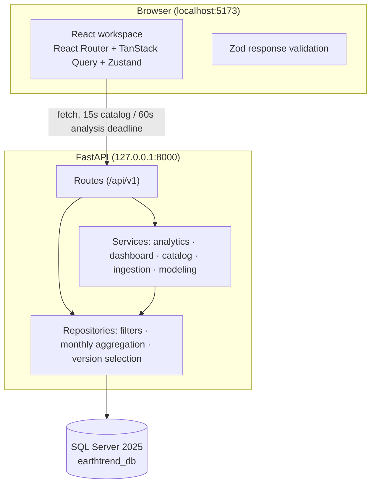

# Architecture

Verified as of November 2026. This document describes the system as implemented, not aspired.

## System context



## Frontend layering

- `src/services/api/client.ts` — one `fetch` wrapper: URL building, 15 s catalog / 60 s analytical timeouts, `AbortController` cancellation, structured `ApiError` (`code`, `status`, `request_id`).
- `src/services/api/environment.ts` — the only HTTP surface live pages use; every response passes the matching Zod schema in `schemas.ts` before reaching the UI. Invalid responses fail loudly instead of rendering.
- `src/hooks/useEnvironment.ts` — TanStack Query hooks: 5-minute stale time, 30-minute GC, no refetch-on-focus, stable query keys, request cancellation wired to the router.
- `src/store/useLabStore.ts` — the Research Lab analysis flow (single-flight, cancellation, progress states).
- Pages live in `src/features/*`; heavy visual assets (`LiveStudyMap`, `Plot`) are `lazy()`-loaded so Leaflet and Plotly never block the first paint.

## Backend layering

- `main.py` — FastAPI app, CORS, structured request logging (`request_id`, route, duration), uniform error envelopes (`code`/`message`/`status`/`request_id`), route handlers.
- `repositories.py` — all query construction: filter clauses, monthly equal-cell-weight aggregation, certified-version selection. No route builds SQL strings.
- `services/analytics.py` — descriptive OLS via SciPy; explicit `method`/`methodology` strings travel with every response.
- `services/dashboard.py` — single bounded aggregate scan shared by the three dashboard projections, with a process cache keyed by `(engine, version_id, sha256, validated_at, certificate, region)`. TTL is one hour because certified versions are immutable.
- `services/ingestion/` — import pipeline and validation policy (used by the operator CLI, not by the UI).
- `services/modeling/` — optional, disabled-by-default model adapter (HTTP/local providers).

## Request lifecycle (main analysis)

```mermaid
sequenceDiagram
    participant UI as Research Lab (Zustand)
    participant API as FastAPI
    participant SQL as SQL Server
    UI->>API: GET /api/v1/analysis/trends?region_id=…&indicator=…&start_date=…&end_date=…&dataset_version_id=6
    API->>API: validate query (TrendFilters), resolve latest certified version
    API->>SQL: monthly aggregate (per cell, then per month) on the version index
    SQL-->>API: monthly rows (values may be NULL)
    API->>API: describe_trend → OLS slope, p-value, CI; missing slots stay NULL
    API-->>UI: TrendRead (series, stats, warnings, verification status)
    UI->>UI: Zod validation → chart, stats, export
```

## Design invariants

1. No mock data in live routes; legacy experiment routes answer HTTP 501 truthfully.
2. Every analytical response carries `dataset_version_id`, `data_verified` and warnings.
3. Aggregation happens in SQL Server; responses are bounded (pages ≤ 500 rows; series limited to 1200 months).
4. The database is the single source of truth; startup runs no migrations and no ingestion.
